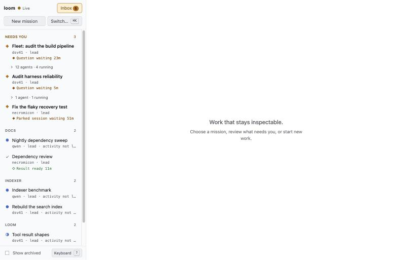
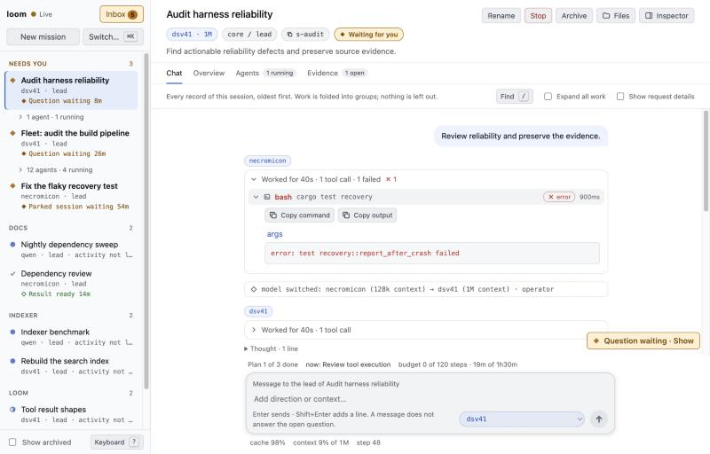
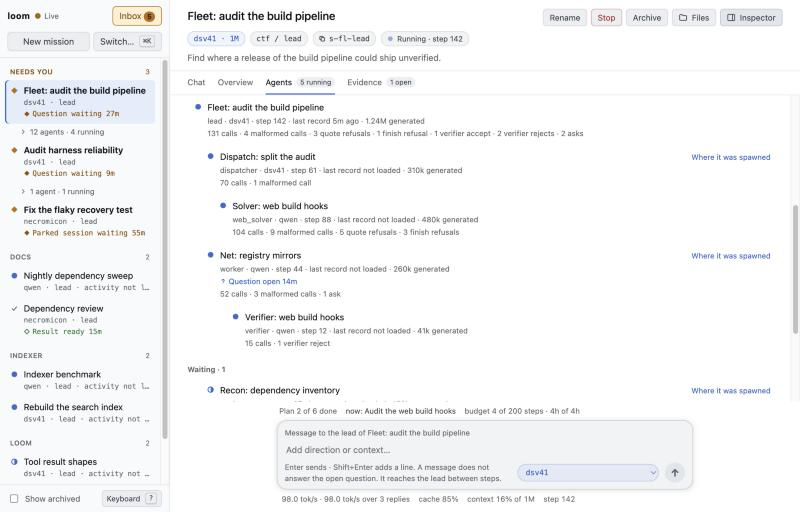
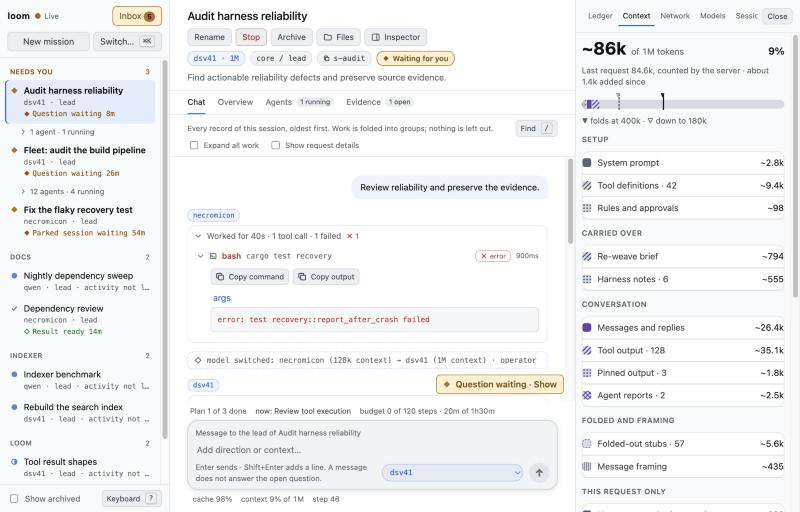

<p align="center">
  
</p>

# loom

An agent harness for long, unattended work on a model you host yourself.

loom is for the case the usual tools are not built for: one operator, an OpenAI-compatible server on
your own network (vLLM and the like, with a large window, automatic prefix caching and several
concurrent sequences), sessions that run for hours while nobody watches, and work where *what was
actually observed* matters more than fluent prose. It is built around the ways long local runs go
wrong: context silently compacted, tool output cut without a trace, questions that wait for hours
because nothing says they are waiting, and state that lived only in the transcript and was lost when
the window filled.

It inverts the cloud assumptions:

- **Tokens are cheap; rebuilding the prefix is what costs.** A cached prefix is free; an edited one is
  re-read from the first change. So a session's request prefix only ever grows, except at explicit,
  logged re-weaves; nothing is trimmed "to save tokens". On a server with prefix caching, a stable
  prefix comes back almost entirely from cache on every later step.
- **Forking is free.** A child that starts from its parent's exact prefix gets a full cache hit, so
  fanning out, verifying and voting all begin with everything the parent already knows.
- **The model is the weakest part, so it gets the smallest job.** The harness owns process, memory,
  bookkeeping and verification; the model fills typed slots inside narrow steps. This does not slow a
  strong model down, and it carries a smaller one.

`docs/DESIGN.md` is the specification; this README is the tour. `docs/RUN.md` is the runbook.

## Screenshots

<table>
  <tr>
    <td width="50%" valign="top">
      <br>
      <sub><b>Missions, grouped by workspace.</b> A pinned <b>Needs you</b> group floats whatever is waiting on you to the top.</sub>
    </td>
    <td width="50%" valign="top">
      <br>
      <sub><b>A session is one conversation.</b> Tool calls fold into work groups you can open; every row has Copy&nbsp;command / Copy&nbsp;output. A chip names the model behind each reply, and a model switch is a visible line.</sub>
    </td>
  </tr>
  <tr>
    <td width="50%" valign="top">
      <br>
      <sub><b>A fleet, by role and state.</b> Lead, dispatcher, solvers, verifiers — each agent's effort is scored: steps, calls, malformed calls, refused finishes, verifier accepts and rejects.</sub>
    </td>
    <td width="50%" valign="top">
      <br>
      <sub><b>What is in the model's window, right now.</b> Every segment counted, the cached and read-anew split, and the marks where the prefix would be re-woven.</sub>
    </td>
  </tr>
  <tr>
    <td width="50%" valign="top">
      <br>
      <sub><b>The inbox.</b> Questions, approvals and parked blockers, grouped by mission, each with its ways out — answer, fold the context, or switch the model.</sub>
    </td>
    <td width="50%" valign="top" align="center">
      <br>
      <sub><b>On a phone.</b> The same record in one scroll; the composer sticks to the bottom and a session's open question lands in view.</sub>
    </td>
  </tr>
</table>

<sub>All shots are from the UI's offline fixture (<code>node tools/ui-preview.mjs</code>): no daemon, model, credentials or real data.</sub>

## Requirements

- Rust 1.88 or newer (`rust-version` in `Cargo.toml`) to build.
- macOS for Seatbelt (`/usr/bin/sandbox-exec`), or x86_64/aarch64 Linux with `/usr/bin/bwrap` for
  `mode = "bubblewrap"` (deny-all shell networking; no proxy bridge). Explicit `mode = "none"` leaves
  every shell command unconfined, including verifier roles. Missing sandbox support fails closed.
- An OpenAI-compatible `/v1/chat/completions` server that streams.
- Optional, for the `dep_scan` tool only: the `depscan` command (OWASP dep-scan) on the daemon's
  `PATH` — e.g. `brew tap owasp-dep-scan/tap && brew install dep-scan`, a standalone release binary,
  or `pip install owasp-depscan` with `npm install -g @cyclonedx/cdxgen`. Loom never installs it.

## Quick start

```
cargo build --release -p loom-daemon      # the binary is target/release/loom
mkdir -p ~/.local/bin                     # or use any other directory on your PATH
install -m 755 target/release/loom ~/.local/bin/loom
loom config init                          # writes ~/.loom/config.toml
$EDITOR ~/.loom/config.toml               # set base_url and model for your server
loom config check                         # prints each profile's lineage, then "ok: <path>", or what is wrong
loom models lineage [profile]             # each profile's family, alignment, recipient and who reviews it
loom monitor                              # the watcher in shadow: what its tripwires have found (changes nothing for an agent)
loom monitor replay --home /path/to/copy  # the tripwires over a home's history, read-only
loom up                                   # start the daemon in the background
loom status                               # the daemon, ✓ or ✗ for your model server, what is running
loom run -w /path/to/workspace "your task in one sentence"
```

`~/.local/bin` must be on your `PATH` (add `export PATH="$HOME/.local/bin:$PATH"` to your shell's
startup file if it is not). Until a session has been created since the daemon started, `loom status`
shows the model and window written in the config; after that, the model id the server serves and the
window it reported.

The daemon reads the config file only when it starts, so write and edit the config before `loom up`,
and run `loom down` then `loom up` after changing it — except `[models]` and `default_model`, which
`loom models reload` applies without a restart. `loom up` starts the program it was run from,
so keep the binary where it is while the daemon runs. If the server cannot be reached when a session
is created and the profile sets no `context_window`, creation is refused with a sentence naming the
URL; set `context_window` or start the server.

By default the tools reach no network host (`[network] mode = "deny_all"`); see "Network" below.

## What it does differently

Each of these is a mechanism, not a line in a prompt.

- **The log is the record; the window is a view.** Every session is an append-only, hash-chained
  event log on disk. The request sent to the model is a pure function of that log (`weave`), so a
  crash, a restart and a context eviction are the same operation: rebuild the view from the log.
- **Window fullness never reaches the model.** It is told once that context is managed and is never
  given a gauge, a message count or an elapsed time to reason about; none of those is ever a reason
  to stop, defer or summarise. Budgets that *do* exist (steps, wall-clock) are named and shown
  separately.
- **Tool output is admitted whole.** The complete output is stored before the model sees any of it.
  If it is too large to show in full, the cut is explicit (which lines were omitted, the sizes, the
  exit status) and the whole thing stays addressable by a handle the model can page (`out_read`) and
  search (`out_grep`). A later eviction replaces old output with a stub that keeps the same handle, so
  "folded out of view" is always distinguishable from "never happened", and the model can pull any of
  it back. Tool calls stay native and are never paraphrased; a call and its result are never
  separated or reordered.
- **State that must outlive the window lives in a sealed ledger.** Goal, constraints, plan, decisions,
  dead ends, claims, evidence, obligations and approvals are typed, HMAC-chained records in a journal
  outside the workspace, written at decision time. A claim may only quote lines the harness actually
  put in front of the model, checked verbatim against the stored bytes, and each piece of evidence is
  graded by how it was obtained — a command that ran, a static analysis, a file read, an external lookup —
  so an analysis (a dependency scan, a decompilation) can never pass itself off as a *run* that concludes a
  goal or settles a verifier's objection. The Markdown you read is a generated view, never parsed back.
- **Stopping is an act.** A turn that ends without a tool call goes through a gate: for a working
  role, if the ledger still has open steps, obligations or unverified claims, the harness says exactly
  what is open and continues; "it has been a while" and "context" are not reasons to stop. Work ends
  only through `finish` (mechanically checked, then, for a role that asks for it, attacked by an
  independent verifier), `ask_user`, `report_blocker` or `wait`.
- **Enforcement sits outside the agent's reach.** Keys, config, harness state and the tool set live
  outside the sandbox's writable area, and the sandbox hides the whole loom home from reads, so a command
  cannot reach another session's log, a stored output or a mission journal. The daemon's own API port is
  refused to commands; Git config, hooks and worktree pointers cannot be planted where commands write; and
  the daemon runs with a cleared environment, so a proxy or credential exported in the shell that started
  it never reaches a model request or a command. Network scope is enforced by a loopback egress proxy plus
  an OS sandbox that permits no other route, not by reading shell text.
- **Nothing leaves the machine unless you configure it.** No telemetry, no analytics, no fallback
  provider. Model requests go only to the server you named.
- **Unattended is the default.** The daemon survives its own restarts (it resumes what was running
  from the logs), stops cascade to every child, every child has a budget, and anything waiting on a
  human raises a notification.
- **A new mission can start from what earlier ones learned.** You name the missions to recall
  (`loom run --prior <mission>`, repeatable, or the web form); before its first step the new lead is
  handed each one's goal, your standing rules and answers, where its work stood when its ledger was last
  written, and its security findings as counts and locators — read from the sealed journals, never
  replayed from a transcript.

## Shape

One binary, `loom`:

```
loom daemon        the long-lived local process; owns everything below
loom <command>     a thin client over the daemon's HTTP API (127.0.0.1, bearer token)
web UI             served by the daemon at / (records, context and the inbox, made visible)
```

Crates:

| crate | what it owns |
|---|---|
| `loom-core` | types, the event log, the blob store, the weave and eviction, admission, the ledger journal, config; all sync and pure |
| `loom-model` | the OpenAI-compatible streaming client, a priority request limiter, retry across a server relaunch, a scripted mock server |
| `loom-tools` | the tool trait and registry, the built-in tools, process and job control, the OS sandbox |
| `loom-net` | the loopback egress proxy and its scope policy |
| `loom-agent` | the session loop, the stop and finish gates, the state block, orchestration, the runtime that owns every session |
| `loom-daemon` | the HTTP API, the embedded web UI, and the `loom` command |

State lives under `~/.loom/` (override with `LOOM_HOME`), never inside a workspace: the config, the
API token (`token`), the journal key (`keys/`), model API keys when you use `api_key_file`
(`keys/models/`), one directory per session (its log, a small summary
and its job files), the content-addressed blob store, one journal per mission, logs, and any packs you
install.

## Tools and roles

Built-in tools: `bash` (its own process group under the sandbox; a long call becomes a tracked
background job rather than being killed, and with `wake_on` the session is resumed when the job
prints a line matching a pattern, not only when it ends) with `job_wait`, `job_kill` and `job_list`; `read`, `write`
and `edit` (regular files only; a write refuses when the file changed since the session last read
it); `glob` and `grep`; `out_read` and `out_grep` (page and search any stored output); `web_fetch`
(through the egress proxy); and `cve_lookup`, `cve_search` and `advisory_lookup` (public vulnerability
databases, through the same proxy); and `dep_scan` (OWASP [dep-scan](https://github.com/owasp-dep-scan/dep-scan)
over a project directory or a CycloneDX SBOM: it runs the operator-installed `depscan` command under
the sandbox, and stores the generated SBOM and the full CycloneDX VDR like any other tool output, so
its prioritized findings can be quoted as evidence). The runtime adds the ledger tools (`plan`, `step`, `note`, `claim`,
`claim_update`, `evidence`, `ledger`, `pin`, `log_search`, `reflect`), the security-state tools (`security_record`,
`security_query`, `security_ingest`), the agent tools (`agent_spawn`, `agent_fanout`, `attempt`, `agent_adopt`,
`agent_message`, `agent_stop`, `decide`, `verify`), `request_scope` (ask the operator for hosts), `conclude` (state that
the goal is met or cannot be met, with evidence) and the tools that end a turn (`finish`, `verdict`, `ask_user`,
`ask_for`, `hand_off`, `report_blocker`, `wait`). Packs can also grant `pty_open`/`pty_exec`/`pty_close`, `http_send`,
`http_repeat`, `codec_calc`, `bin_survey`, `bin_decompile`, `bin_xrefs`, `gdb_probe` and `oracle_check`. Which of them a
session has depends on its role, and a role is shown only one tool per job: a tool another one covers (`out_read` by
`read`, `claim_update` by `claim`, …) still runs if called but is not listed (`docs/TOOL-SHAPES.md` §4).

A **pack** is a set of roles; a role is a prompt, a tool list and how it ends. The built-in `core`
pack has `lead` (owns a mission, plans, delegates, finishes through the gate), `worker` (one
assignment, returns quoted evidence), `verifier` (read-only; tries to refute a claim) and `chat` (a
plain turn-by-turn assistant). Domain discipline, such as a research pipeline with its own stages and
evidence tiers, is a pack, not core.

## Commands

```
loom run -w /path/to/workspace "task"     start a lead session in that directory and follow it
loom run ... --prior <mission>            also recall what one or more earlier missions learned
loom run ... --create-workspace           make the workspace folder first if it does not exist
loom chat                                 a turn-by-turn chat session on the terminal
loom ls                                   sessions, their state and context size
loom tail <session>                       follow a session's record
loom send <session> "message"             add a message to a session
loom stop <session> | resume <session>    stop the current turn, or let a stopped session carry on
loom inbox                                questions, approvals and blockers waiting for you
loom answer <item> "..."                  answer one
loom rule <session> "text"                set a standing rule for the mission
loom rule <session> --withdraw <rule-id> [--reason "..."]
loom approve <session> "text" [--scope "..."]
loom scope <session> <host>...            let the mission's tools reach these hosts (a session asks with request_scope)
loom scope revoke <mission> <host> --reason "..."   take a granted host back (recorded, cut at once)
loom release <session> "reason"           accept a blocked mission as it is and close it
loom ledger <session>                     the mission ledger
loom score <session> [--json]             what the mission's work took: steps, refused finishes, malformed calls
loom window <session>                     what is in the model's context right now
loom net <session>                        every network request and how it was decided
loom open                                 open the web UI in a browser
loom gc [--apply]                         delete stored outputs nothing refers to (dry run unless --apply)
loom models list                          the model profiles in use and whether each server answers
loom models reload                        read [models] from the config again — no restart
loom models set <session> <profile>       switch a session to another model from its next step — no restart
loom models show <session>                a mission's models: the lead's, each agent role's, the agents running
loom models role <session> <role> <profile>  start the mission's agents of a role (or `all`) on a profile
```

A `<session>` is an id, the beginning of one, or `last`. `docs/RUN.md` lists every command and option.

## Network

The daemon binds `127.0.0.1` and every API request carries a bearer token, so it is reachable only
from the machine it runs on. Commands the model runs can reach the network only through the
daemon's egress proxy, and the proxy's policy comes from `[network]` in the config:

- `deny_all` (the default): tools reach no host. Requests to your model server are not affected.
- `allowlist`: only hosts matching `allow` are reachable.
- `open`: any public host is reachable. Private, loopback and link-local addresses are still refused
  unless listed in `allow_private`.

Whatever the config says, you can let one session reach more: an agent that needs a host asks, the request
waits in your inbox without stopping it, and `loom scope <session> <host>...` (or the Approve button)
grants it for that session only.

`web_fetch` and the vulnerability-lookup tools need a route, so with the default they fail with a
refusal that names the policy. `docs/config.example.toml` shows an allowlist. `dep_scan` runs locally
once installed, but a first scan downloads dep-scan's vulnerability database (and `cdxgen` may reach
its ecosystem registries), so it needs a route for those hosts too.

To use a daemon that runs on another machine, forward its port over SSH and give the client that
daemon's token; `docs/RUN.md` has the recipe.

## Seeing it: the web UI and the desktop app

The daemon serves a web UI at `/`: missions grouped by workspace on the left, with a pinned *Needs you*
group first; in the middle each session as one **chat** — the whole record as a conversation, tool calls
folded into work groups you can open, a chip on every reply naming the model that produced it (a model
switch is a visible line), and a composer with a model seat that moves the session to another model from
its next step; on the right an inspector with the mission ledger, a **context card** that shows exactly
what is in the model's window, by segment and with the fold marks, the inbox and the network decisions.
An **Agents** tab shows a mission's fleet by role and state with each agent's score; a **Files** tab
browses the session's workspace, read-only. Copy buttons sit on every reply, code block, tool command or
output and quoted line, and it reads on a phone: one scroll, a sticky composer and a session-details
sheet. The page is static, strict-CSP, has no build step, and updates live over SSE. Run `loom open` to open it: the command asks
the daemon for a one-time login code and opens the page with it. The page needs no cookie; it keeps
a secret in the tab's session storage and asks you to run `loom open` again when that is gone.

**loom-desk** (`gui/`) is a small native macOS app around that UI, for leaving missions running and
glancing at them. It manages connections (a named host, an SSH tunnel it opens for you, the token it
fetches), shows running and waiting counts in the menu bar, and raises an OS notification the moment a
mission needs you. See `gui/README.md`.

## Packs

A pack is a set of roles. `core` (built in) is general. `vr` (`packs/vr/`) is a vulnerability-research
pipeline (scope gate, evidence tiers, a judge that attacks the researcher's finish, a report-readiness gate)
expressed as roles, ledger records and the harness's own checks. It is not installed by default; see
`packs/vr/README.md`. `packs/vr/workspace/AGENTS.md` is its standards file, to copy into an engagement
workspace for the agents to read.

`packs/ctf` and `packs/redteam` add bounded specialist roles, typed security state and independent
operator-contract verification. They are opt-in and require explicit scope and acceptance setup;
see [CTF](packs/ctf/README.md), [Redteam](packs/redteam/README.md), and the
[qualification protocol](docs/SECURITY-EVAL.md). External model/corpus performance is unmeasured.

`harnessmm` is an opt-in experimental pack for bounded guarded continuations. See
[`docs/HARNESSMM.md`](docs/HARNESSMM.md) for its limits and evaluation protocol.

The adversarial monitor (deterministic tripwires, a cross-family reviewer, a gate for irreversible actions, a durable
pause, and the operator-armed "keep going") is specified in [`docs/MONITOR.md`](docs/MONITOR.md) and built in phases;
this build has the floor (infrastructure deny, fetch-service and mach-lookup denies, process census, proxy controls),
model lineage, and the tripwire monitor in shadow: the daemon runs it, and it records what it finds without steering,
pausing or refusing anything. The reviewer, the action gate, the pause and "keep going" are later phases.

## Building and testing

```
cargo build --release -p loom-daemon      # the `loom` binary, target/release/loom
cargo test --workspace                    # the Rust suite
cargo clippy --workspace --all-targets -- -D warnings
node --test ui/core.test.js               # the web UI's logic; needs Node.js 22.12 or newer
cargo run -p loom-agent --example eval    # scripted models against the mock server: what each run took
```

`./x` is an optional wrapper that runs cargo on another machine named by `LOOM_BUILD_HOST` (and
`LOOM_BUILD_HOST=local` runs it here); you do not need it. It has no default host: when
`LOOM_BUILD_HOST` is unset it stops with a message saying to set it. The
desktop app builds with `gui/build.sh`, which requires `LOOM_BUILD_HOST`. `docs/IMPLEMENTING.md` is
the contributor guide.

## Reporting a vulnerability

See `SECURITY.md`. Changes between versions are in `CHANGELOG.md`.

## License

MIT.
