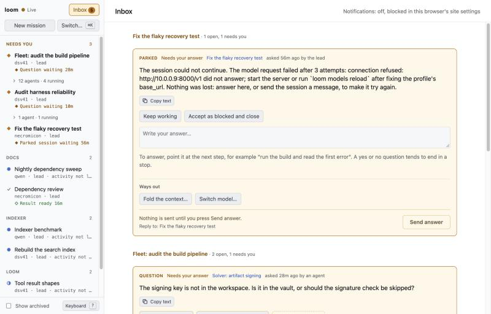
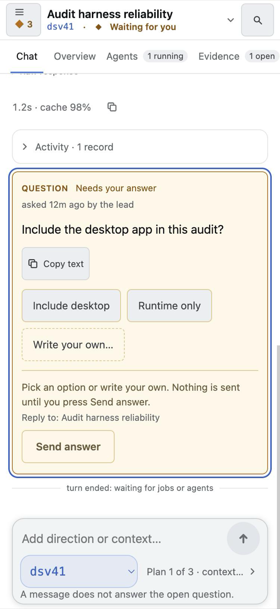

<p align="center">
  
</p>

<h1 align="center">ferret</h1>

<p align="center">
  <strong>A general-purpose local AI agent harness for long, unattended work on self-hosted models — with opt-in packs that turn it into a bounded cyber &amp; vulnerability-research harness.</strong>
</p>

<p align="center">
  <code>Rust 1.88+</code> &middot; <code>macOS &amp; Linux</code> &middot; <code>Native macOS App</code> &middot; <code>Web UI</code> &middot; <code>Two-Way Signal</code> &middot; <code>Zero Telemetry</code> &middot; <code>MIT</code>
</p>

---

Ferret is built for the workflow most cloud agent tools ignore: one operator, an OpenAI-compatible model server on your own network (`vLLM`, `SGLang`, `MLX`, `llama.cpp`, and similar — with large windows, automatic prefix caching, and concurrent sequences), sessions that run for hours unattended, and work where *what was actually observed* matters more than fluent prose.

Its core is strictly **general-purpose** — software engineering, debugging, systems work, and long multi-agent research — while modular **packs** (`vr`, `redteam`, `ctf`, `ctf-generalist`, `harnessmm`) layer domain roles, security tooling, and verification gates cleanly on top without polluting the base runtime.

### Why Ferret Exists

Ferret inverts the usual cloud-agent assumptions:

- **Tokens are cheap; rebuilding the prefix is what costs.** A cached prefix is nearly free; mutating an earlier turn invalidates everything after it. A Ferret session's request prefix only grows between explicit, logged compactions — maximizing prefix-cache hits on local inference servers.
- **Forking is free.** A child agent forked from its parent's exact prefix starts with a warm KV cache, making parallel fan-out, independent verification, and competing approaches practical even on local hardware.
- **The harness owns rigor; the model fills typed slots.** Process control, memory, evidence grading, stop gates, and verification live in Rust outside the model's reach — accelerating strong models while keeping smaller local models disciplined.

---

## Core Capabilities

| Area | What Ferret Provides |
|---|---|
| **Crash-Safe Event Log &amp; Weave** | Every session is an append-only, hash-chained log on disk. The prompt window is a pure function (`weave`) of that log — restarts, reconnects, and compactions rebuild identically from history. |
| **Whole-Output Admission** | Full tool outputs are stored content-addressed before the model sees them. Truncations are explicit and addressable by handle (`out_read` / `out_grep`), and evicted turns leave traceable stubs instead of silent gaps. |
| **HMAC-Sealed Mission Ledger** | Goals, constraints, plans, decisions, claims, graded evidence, approvals, and standing rules live in a tamper-evident journal outside the workspace. Claims are mechanically verified against verbatim stored tool output. |
| **Mechanical Finish &amp; Verifier Gates** | Working roles cannot wander off because context feels long; turns end only via explicit actions (`finish`, `ask_user`, `report_blocker`, `wait`), and `finish` can require sign-off from an independent read-only verifier/judge. |
| **Four Operator Surfaces** | Control missions seamlessly from the **CLI** (`ferret`), the embedded strict-CSP **Web UI**, the native macOS **`ferret-desk.app`**, or **two-way Signal** alerts and quote-replies on your phone. |
| **Defense-in-Depth Sandboxing** | Local OS confinement (**macOS Seatbelt** / **Linux Bubblewrap**), loopback egress proxy with per-session scope grants, cleared daemon environment, plus optional **remote Docker/Colima container sandboxes (`[box]`)** over SSH with per-mission `iptables`/`ip6tables` isolation. |
| **Prior-Mission Recall** | Seed new runs with `--prior <mission>` to carry forward sealed goals, operator rules, progress, and security findings without replaying raw transcripts. |
| **Zero Telemetry** | Nothing leaves your network unless you explicitly configure a model endpoint, allowlist host, MCP server, email inbox, or Signal daemon. |

---

## Architecture

```text
┌──────────────────────── Operator Surfaces ────────────────────────┐
│  ferret CLI (TTY / --json)   Web UI (SSE, strict CSP, mobile)     │
│  ferret-desk.app (macOS)     Signal Bridge ([signal] two-way)     │
└───────────────────────────────┬───────────────────────────────────┘
                                │ 127.0.0.1:7878 (bearer token / SSH tunnel)
┌───────────────────────────────▼───────────────────────────────────┐
│                   ferret daemon (ferret-daemon)                   │
│  Session Runtime · Sealed Ledger · Blob Store · Inbox · Mailbox   │
│  Loopback Egress & MITM Proxy (ferret-net: HAR, rewrites, pacing) │
└───────────┬───────────────────────────────────────────┬───────────┘
            │ Local OS Sandbox                          │ Optional [box] (SSH-forwarded Docker socket)
            ▼                                           ▼
  Seatbelt (macOS) / Bubblewrap (Linux)       Remote Container Host (e.g. second Mac Studio / Linux)
  Workspace-confined tools & jobs             Read-only container · tmpfs /work · per-mission iptables
```

State lives under `~/.ferret/` (override via `FERRET_HOME`), never inside target workspaces — keeping config, bearer tokens, HMAC journal keys, model API key files, interception CA keys, blobs, sessions, and mission journals completely unreadable to sandboxed commands.

---

## Screenshots

<table>
  <tr>
    <td width="50%" valign="top">
      <br>
      <sub><b>Missions by workspace.</b> A pinned <b>Needs you</b> group floats questions, approvals, and parked blockers to the top.</sub>
    </td>
    <td width="50%" valign="top">
      <br>
      <sub><b>Session conversation.</b> Folded tool groups with one-click copy, per-reply model chips, and live mid-session model switching.</sub>
    </td>
  </tr>
  <tr>
    <td width="50%" valign="top">
      <br>
      <sub><b>Multi-agent fleet.</b> Live role hierarchy and effort scorecards: steps, tool calls, refused finishes, and verifier verdicts.</sub>
    </td>
    <td width="50%" valign="top">
      <br>
      <sub><b>Exact context visibility.</b> Every segment counted, cached vs. uncached split, and compaction boundaries.</sub>
    </td>
  </tr>
  <tr>
    <td width="50%" valign="top">
      <br>
      <sub><b>Operator inbox.</b> Questions, host-scope requests, approvals, and blockers — answer, grant scope, compact, or swap models.</sub>
    </td>
    <td width="50%" valign="top" align="center">
      <br>
      <sub><b>Mobile web &amp; Signal.</b> Single-column mobile UI plus native Signal alerts and quote-replies when you are away from your desk.</sub>
    </td>
  </tr>
</table>

<sub>Generated from the offline UI fixture (<code>node tools/ui-preview.mjs</code>) with no live daemon or credentials.</sub>

---

## Packs — General-Purpose Core to Cyber Harness

A **pack** defines roles, system prompts, allowed tools, and verification contracts on top of Ferret's runtime:

| Pack | Purpose | Highlights |
|---|---|---|
| **`core`** *(built-in)* | General-purpose engineering &amp; research | `lead`, `worker`, `verifier` (read-only), and `chat`. Full coding, debugging, web/CVE lookup, MCP, and `[box]` support. |
| **`vr`** ([README](packs/vr/README.md)) | Vulnerability research | Scope gates, graded evidence tiers, adversarial `judge` on finish, and report-readiness checks. |
| **`redteam`** ([README](packs/redteam/README.md)) | Bounded adversary emulation | `commander`, `recon_operator`, `tactical_operator`, `lateral_operator`, and independent `op_judge` verification. |
| **`ctf`** ([README](packs/ctf/README.md)) | Specialist CTF solving | `dispatcher` fanning out to `web_solver`, `binary_solver`, `crypto_solver`, and `solver` with `flag_judge` verification. |
| **`ctf-generalist`** ([README](packs/ctf-generalist/README.md)) | Unified CTF A/B benchmark | Same safety/oracle/`flag_judge` contract as `ctf` with a single unified 32-tool `solver` for cross-domain chains. |
| **`harnessmm`** ([docs](docs/HARNESSMM.md)) | Experimental continuations | Bounded guarded continuations for long-horizon evaluation protocols. |

### Built-In Security &amp; Offensive-Engineering Primitives

Opt-in cyber workflows layer directly onto Ferret's core daemon:

- **Structured Security State &amp; SARIF 2.1.0:** Typed per-surface coverage provenance, CVSS/CWE findings with 3-axis fingerprint deduplication, and `ferret sarif` export ([`docs/SECURITY_STATE.md`](docs/SECURITY_STATE.md)).
- **HTTPS Interception &amp; HAR 1.2 Interop:** Per-target credential injection, captured exchange inspection (`ferret traffic`), live operator-only proxy rewrite rules (`ferret rewrite`), and bidirectional Burp/ZAP/DevTools **HAR 1.2** import/export (`ferret har`).
- **Egress Noise Governor &amp; Assessment Identity:** Configurable pacing profiles (`quiet` / `balanced` / `aggressive`), backoff telemetry (`ferret net --noise`), and origin-scoped `Ferret-Assessment/1.0` `User-Agent` headers.
- **Scoped Read-Only Email Inbox (`[mail]`):** Optional IMAP/Maildir `inbox_read` tool gated by strict sender allowlists and authentication checks (`SPF`/`DKIM`/`DMARC`) for verification codes and bug-bounty platform mail.

---

## Requirements

- **Rust `1.88+`** (`rust-version` in [`Cargo.toml`](Cargo.toml))
- **OS Sandbox:** macOS (`/usr/bin/sandbox-exec` Seatbelt) or Linux x86_64/aarch64 (`/usr/bin/bwrap` Bubblewrap); missing sandbox support fails closed unless `mode = "none"` is explicitly configured
- **Model Server:** Any streaming OpenAI-compatible `/v1/chat/completions` endpoint
- **Optional:**
  - macOS `14+` with Xcode Command Line Tools (`swiftc`) for **`ferret-desk.app`**
  - Remote or local Docker/Colima host over SSH for containerized **`[box]`** execution
  - **`signal-cli`** HTTP daemon (`daemon --http 127.0.0.1:1337`) for two-way **`[signal]`** alerts &amp; phone replies
  - OWASP **`depscan`** on `PATH` for the optional `dep_scan` tool

---

## Quick Start

### 1. Build &amp; Run the Daemon

```bash
cargo build --release -p ferret-daemon
mkdir -p ~/.local/bin
install -m 755 target/release/ferret ~/.local/bin/ferret

ferret config init                  # writes ~/.ferret/config.toml
$EDITOR ~/.ferret/config.toml       # configure [models.*] base_url and model
ferret config check                 # validates config, keys, packs, and integrations
ferret up                           # starts the background daemon on 127.0.0.1:7878
ferret status                       # verifies daemon, model reachability, Signal, disk
```

Launch a mission or open the Web UI:

```bash
ferret run -w /path/to/workspace "audit the auth middleware and add regression tests"
ferret open                         # mints a one-time login code and opens the Web UI
```

> **Tip:** Edit `[models]` or `default_model` anytime and apply without restarting via `ferret models reload`, or switch a live session mid-flight with `ferret models set <session> <profile>`.

### 2. Native macOS Desktop App (`ferret-desk.app`)

`ferret-desk` wraps the Web UI in a hardened `WKWebView` with zero JS injection, built-in SSH tunneling to remote daemon hosts, Keychain token storage, menu bar &amp; Dock badges, native macOS notifications, file upload/download dialogs, find-in-page (`⌘F`), and sleep/wake tunnel recovery.

```bash
FERRET_BUILD_HOST=local bash gui/build.sh
open gui/dist/ferret-desk.app
```

See [`gui/README.md`](gui/README.md) for code-signing, keyboard shortcuts, and remote daemon connection setup.

### 3. Two-Way Signal Alerts (`[signal]`)

Configure `[signal]` in `~/.ferret/config.toml` against a local `signal-cli` HTTP daemon (see [`docs/config.example.toml`](docs/config.example.toml) and [`docs/RUN.md`](docs/RUN.md#signal)):

```bash
ferret signal check                 # checks signal-cli HTTP health, account, and bridge state
ferret signal test                  # sends a live test message to your configured recipient
```

From your phone you can **quote-reply** to any alert to answer questions, grant/deny host scope requests (`approve`, `1 2`, `deny`), steer a session, or run commands: `/inbox`, `/status`, `/tail`, `/scope`, `/dismiss`, `/stop`, `/resume`, `/approve`, `/rule`, `/release`, `/mute`, `/unmute`, `/help`.

### 4. Split-Host Daemon + Remote Sandbox (`[box]`)

Ferret natively supports running the daemon on one host and isolated Linux containers on a second host over a supervised SSH-forwarded Docker/Colima socket with digest-pinned `arm64`/`amd64` images and per-mission `iptables`/`ip6tables` chains (`FERRET-ALL` / `FERRET-<id>`, bridge `fb-<id>`). See [`docs/RUN.md`](docs/RUN.md) and [`docs/config.example.toml`](docs/config.example.toml) for the full `[box]` recipe.

---

## CLI Quick Reference

Most commands accept a session/mission ID, prefix, unique 4+ char suffix, or `last`, and support `--json` (or JSONL on `tail`) for scripting.

### Missions &amp; Sessions

```bash
ferret run -w <dir> "task" [--pack <name>] [--prior <mission>] [--create-workspace]
ferret chat                                         # interactive terminal chat
ferret ls [-a] [--wide] [--json]                    # sessions, mission IDs, state, context
ferret tail <session> [-n <N>] [--no-follow] [-v] [--json]
ferret send <session> "message" [--after-turn] [-d]
ferret queued list|edit|send|rm <session>           # manage --after-turn queue
ferret stop <session> | resume <session> | compact <session>
ferret rename <session> "title" | archive <session> [--undo]
```

### Operator Inbox &amp; Governance

```bash
ferret inbox [--json]                               # open questions, scope requests, blockers
ferret answer <item|last|.> ["..." | 1..N | --dismiss]   # also reads piped stdin
ferret scope <session> <host>...                    # grant per-session egress hosts
ferret rule <session> "text" | --withdraw <id> [--reason "..."]
ferret approve <session> "text" [--scope "..."]
ferret release <session> "reason"                   # close a blocked mission cleanly
```

### Inspection, Security &amp; Traffic

```bash
ferret ledger <session|mission> [--json]            # sealed mission ledger
ferret score <session|mission> [--json]             # effort & verifier scorecard
ferret window <session> [--json]                    # exact context-window breakdown
ferret out <handle> [--lines a:b]                   # inspect stored tool outputs
ferret findings <session|mission> [-a] [--severity <lvl>] [--json]
ferret sarif <session|mission> [-o findings.sarif]  # SARIF 2.1.0 export
ferret traffic <session> [--host <h>] [-n N] [--json]
ferret har export <session> [-o out.har] | import <session> <file.har>
ferret rewrite list|add|enable|disable|rm|example   # live proxy rewrite rules
ferret net <session> [--json] | --noise             # egress log or noise-governor stats
ferret target list|add|show|scope                   # shared target scopes & graphs
ferret creds list|show|record|set|rm <target>       # in-scope target auth profiles
ferret ca show | rotate                             # HTTPS interception CA
```

### Models, Packs, Integrations &amp; Daemon

```bash
ferret status [--json]                              # daemon, models, live Signal bridge, disk
ferret packs [--json]                               # installed packs & roles
ferret models list|reload|show|set|role             # hot-reload & mid-session switching
ferret mcp list | check <server>                    # MCP server inspection
ferret mail check                                   # scoped read-only inbox check
ferret signal check | test [message...]             # two-way Signal bridge diagnostics
ferret open [--print]                               # open Web UI with one-time code
ferret gc [--apply]                                 # prune unreferenced blobs
ferret up | down | service install                  # daemon & LaunchAgent lifecycle
```

---

## Workspace Crates

| Crate | Responsibility |
|---|---|
| [`ferret-core`](crates/ferret-core) | Domain types, hash-chained event log, content-addressed blob store, pure `weave`/compaction, output admission, HMAC-sealed ledger journal, SARIF 2.1.0, HAR 1.2, and config validation |
| [`ferret-model`](crates/ferret-model) | Streaming OpenAI-compatible client, priority request limiter, restart-resilient retries, and scripted mock server |
| [`ferret-tools`](crates/ferret-tools) | Tool registry, sandboxed `bash`/PTY/job control, file/search/web/CVE/binary/mail tools, OS sandboxes (`seatbelt`/`bwrap`), and remote `[box]` Docker controller |
| [`ferret-net`](crates/ferret-net) | Loopback HTTP/HTTPS MITM egress proxy, scope policy, credential injection, rewrite rules, and noise governor |
| [`ferret-agent`](crates/ferret-agent) | Session loop, stop/finish/verifier gates, multi-agent orchestration, pack loader, security state, and runtime |
| [`ferret-daemon`](crates/ferret-daemon) | Bearer-authed HTTP/SSE API, embedded Web UI, two-way Signal bridge, terminal renderer, and `ferret` CLI |

---

## Building &amp; Testing

```bash
cargo build --release -p ferret-daemon              # target/release/ferret
cargo test --workspace                              # full Rust test suite
cargo clippy --workspace --all-targets -- -D warnings
node --test ui/core.test.js                         # Web UI logic & security checks (Node 22.12+)
python3 -B tools/security-eval.test.py              # eval tooling checks
FERRET_BUILD_HOST=local bash gui/build.sh           # native macOS ferret-desk.app
```

---

## Documentation

- [`docs/DESIGN.md`](docs/DESIGN.md) — Architecture &amp; core specification
- [`docs/RUN.md`](docs/RUN.md) — Operator runbook, CLI reference, Signal setup, and remote `[box]` guide
- [`docs/config.example.toml`](docs/config.example.toml) — Complete annotated configuration reference
- [`docs/SECURITY_STATE.md`](docs/SECURITY_STATE.md) — Findings, coverage provenance, SARIF/HAR, rewrite rules, `[mail]`, and `[signal]`
- [`docs/RUNTIME-CONTROLS.md`](docs/RUNTIME-CONTROLS.md) — Runtime governance, compaction, and steering controls
- [`docs/UI.md`](docs/UI.md) &amp; [`gui/README.md`](gui/README.md) — Web UI and macOS `ferret-desk` guides
- [`docs/IMPLEMENTING.md`](docs/IMPLEMENTING.md) — Contributor guide
- [`SECURITY.md`](SECURITY.md) &middot; [`CHANGELOG.md`](CHANGELOG.md) &middot; [`LICENSE`](LICENSE)

## License

MIT — see [`LICENSE`](LICENSE).
