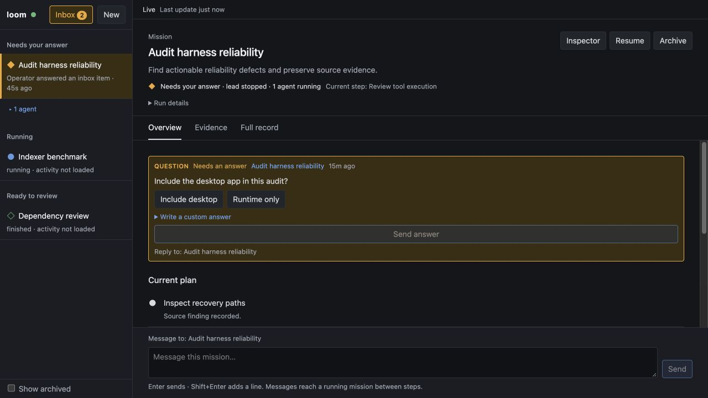

# The web UI

The operator supervises missions through four static files in `ui/`: `index.html`, `style.css`,
`core.js`, and `app.js`. The daemon embeds them; there is no frontend build step or runtime
framework. `core.js` owns pure state and presentation decisions; `app.js` owns DOM and network IO.

## Content and authority

- Keep the daemon's strict CSP: scripts, styles and requests are same-origin; no inline handlers,
  executable record content, remote images, analytics, or third-party resources.
- Model prose may use a small presentation subset: headings, paragraphs, lists, bold text, inline
  code and fenced code. Create each element and text node directly. Source HTML, links and images
  stay inert. Every formatted response also exposes its exact raw text. Tool output stays raw.
- The event log remains the record. Overview text is derived deterministically from records and
  typed ledger fields; it is not a generated summary or a substitute for the full record.
- Display a quote's attestation as “Quote matches stored output.” Keep that distinct from recorded
  claim status and independent verification. The runtime refuses a quote that does not match, so
  an unattested quote is one it did not check: show “Quote not checked against stored output”,
  never a failed match. Opening evidence in the UI never changes model observation coverage or
  verifies a claim.
- Icons are drawings in the `<template id="icons">` of `index.html`, cloned by `app.js`. Markup is
  never built from strings, and a namespaced element is never created from script (the namespace
  URL would break the no-remote-URL check). Every drawing is `aria-hidden`; the words beside it
  carry the meaning, and each state has its own shape so it is not told apart by colour alone.
- **Authentication** is a bearer secret; there is no cookie. The page and its three assets need no
  authentication; every `/api` request does, except the code exchange `POST /api/web-sessions`, where
  the login code is the credential. `ferret open` (or ferret-desk) opens the page as
  `/#code=<login code>`: at load the page takes the single-use code from the fragment, removes the
  fragment with `history.replaceState`, and trades the code for a web-session secret
  (`POST /api/web-sessions {code}` → `{secret}`). The secret is kept in `sessionStorage` (in memory
  when storage is blocked) and sent as `Authorization: Bearer <secret>` on every request, event
  stream included; every `fetch` uses `credentials: "omit"`. With no code and no stored secret, or
  on a `401` anywhere, the page is replaced with: `This page is not signed in. Run "ferret open"
  again.` Web-session secrets live in the daemon's memory, so a daemon restart needs `ferret open`
  again.

## Missions and navigation



The sidebar lists root sessions grouped by workspace: the heading is the last component of the
workspace path (the full path is its tooltip), groups are ordered by most recent activity, and roots
inside a group likewise. A root's activity is the newest record of its whole mission. A **Needs you**
group is pinned on top whenever a root has a blocking item (its own or a child's); those roots appear
there instead of under their workspace. Agents are collapsed under the root by default; opening an
agent expands its ancestors. Archived roots remain hidden until Show archived is enabled.

Each row has one status mark, chosen by strict precedence: needs you, running, new since your last
visit (records after the stored watermark; a session never visited is not marked new), ended
failed, then idle or ended. An ended session whose outcome is `stopped` has its own square shape, not
the check of one that finished. A mission counts as running, or as waiting for jobs or agents, when any
session in it is. Every mark has its own shape and a word for assistive technology, so the state is
never told by colour alone. Line 1 is the title. Line 2 is the identity line in monospace,
`<profile> · <role> · <age>`. The profile is never truncated, so the model is readable at the sidebar's
272px; only the role and age after it may be cut. When something waits on the operator, the identity
line drops the age and the reason is a line of its own below it (for example "Approval waiting 5m", or
"3 requests waiting", in amber with the diamond shape). A nonblocking question ("Question open 2m",
a question mark in blue) and an available result ("Result ready 10m", an outline diamond in green) are
said the same way, without the urgent treatment. The age is the time of the latest recorded event the
page has seen, kept in tab storage beside the watermarks so it survives a reload; for a session whose
records have not been loaded the line leaves the age out ("qwen · lead") and its tooltip says the activity
is not loaded yet; repeating "not loaded" on every row was noise. The creation time orders such rows but is
never shown as an age. An agent row in the Agents tab likewise leaves out "last record" until one is known. The
earlier row summary (what waits and for how long, how the root stands, recorded activity) remains the
row's tooltip and description, so nothing it said is lost. Blocking requests, nonblocking questions
and available results have different labels, and only blocking requests use the urgent attention
treatment. Ages come from recorded times, never from creation, and activity that has not been loaded
is explicitly unknown. The open session's row is never "new": opening it, or returning to it from
Inbox or New mission, moves its watermark to the latest record. The agents toggle under a mission says how many agents it has and how many are
running. Token counts and step counters are run details rather than a measure of completion.

### Live data and the event stream

- At load: `GET /api/sessions?archived=true`, `GET /api/inbox`, `GET /api/status`; then one stream
  on `/api/events?deltas=true` for everything live. `EventSource` cannot send an `Authorization`
  header, so the stream is read with `fetch` and a streaming reader, and `core.js` parses the
  server-sent events. No frame has an `event:` field: each has a `data:` line with one JSON object
  whose `type` is the kind (`session`, `record`, `delta`, `status`, `net`, `settled`, `error`,
  `lagged`), and a `record` frame also has `id: <seq>`. The daemon sends a comment every 15 s; a
  stream silent for 45 s is dropped. A dropped stream is opened again after 1 s, doubling up to 15 s;
  the header's dot is red meanwhile.
- Opening a session: `GET /api/sessions/{id}/records` page by page (`after`, `next_after`) until
  the end, then keep it current from the event stream (records carry `seq`: apply one only if it
  is the next one; a gap means fetch the missing page). Sessions not open are not fetched.
- `lagged`, or the stream reconnecting: refetch the session list, the inbox, the status, the open
  mission's ledger and the open session's records after the last seq held. The session list is one request
  in flight plus one queued, and a session an event changed while it was out is kept over the snapshot;
  the inbox is also read every 60 s.
- A blocking inbox item is also announced with the browser's `Notification` API when permission was
  granted (a button in the inbox view asks for it; never ask unprompted).

The New mission form (`#/new`) has an optional *Recall earlier missions* field: mission ids separated by
spaces or commas (at most 8). They are sent as `prior` (`core.buildNewSession`); the daemon checks that each
mission exists, and the new lead starts with one note of what those missions recorded in their sealed
ledgers (`ferret_agent::prior`), visible in its record like any harness note.

Routes are `#/s/<id>/chat`, `/overview` and `/evidence`. `#/s/<id>` and `/chat` open Chat, the
default tab; the earlier `/record` is accepted and rewritten to `/chat` with `history.replaceState`.
ferret-desk opens `#/s/<id>`, which keeps working. `#/inbox` and `#/new` retain their meaning. Browser
Back/Forward restores the selected mission view.

The sidebar header holds the connection dot, a short connection word (`Live`, `Connecting…`,
`Reconnecting…`, `Offline`) and the inbox count; **New mission** is a full-width button below it. The
detail (the last-update time, a failed status request, each unreachable model profile) is the tooltip
of that line and of the dot, not text in the sidebar; an unreachable model is also on the `#s-model`
chip. At 1100px and narrower the sidebar and inspector are drawers, and the top bar is shown. It holds
their buttons and a compact identity summary of the open session that is always in view: `#bar-model`
(the profile, in the look of `#s-model`, its tooltip the full model text, with the unreachable
warning) and `#bar-run` (the run state with its shape). Both follow the header on every update and are
hidden when no session is open. They sit inside one button, `#bar-details`, which opens the session details sheet (see
"Phone layout"); from 700px up it is the same chip row as before. Below 700px the bar is one row of about 52px: the
Missions button (`#open-left`, a menu drawing with the word read out, and `#bar-needs`, a diamond and the number of
blocking items, so its name is "Missions, 3 need you"), the session as two lines (`#bar-title`, then the model and run state
in one ellipsized line with their shapes), and `#bar-find`. A lost connection is also said in the bar there (under 700px
only, so a screen reader does not hear it twice beside the open sidebar): a visible alert shape and "Offline ·" before
the caption, and the status sentence for assistive technology.

The session header is an identity bar. Line 1 is the breadcrumb: for an agent, the mission title,
an ellipsis where ancestors are skipped, and its role, with ancestors as links to their sessions; for a
root, just the title. The current crumb is the title (the id when untitled; its tooltip is the full
id), and the action buttons (Rename, Stop, Resume, Archive, Unarchive, Inspector) sit on the right.
Line 2 is a row of chips that wraps and is never hidden at any width:

- `#s-model`: the model in effect now, `<profile> · <model id> · <context window>` (for example
  `qwen · qwen4-max-preview · 1M`; a profile named for its model says it once: `dsv41 · 1M`), in monospace with an accent tint. Its tooltip gives the base URL
  and whether the profile is reachable (from `/api/status`). A profile reported unreachable adds an
  alert shape and the word "unreachable". It updates live from a `session` frame or a `model_switched`
  record.
- `#s-role`: `<pack> / <role>`; for an agent, the tooltip says which mission it belongs to.
- `#s-id`: a button showing the first ten characters of the session id, with an ellipsis when it was cut. It copies the full id and says
  "Copied" briefly, also to assistive technology. Without clipboard access it selects the whole id
  and says so.
- `#s-run`: the run state in words with its shape: `Running · step N · <time since this run began>`,
  `Idle · step N`, `Waiting for you`, or `Ended · <outcome>`; an open nonblocking question adds
  `· question open` and a result waiting to be reviewed `· result ready`, so these are said in words
  and not only by shape. The elapsed time updates at most once a second and only while running and
  while the event stream is connected: with the stream down the chip reads `Last known · …` without
  a clock.
- `#s-standing`: the standing chips, separate facts: what is waiting on the operator, how the lead (or
  agent) stands, and how many agents are running. A root session is called the lead only when its role
  is `lead`.

Line 3 is the goal, `#s-goal`, clamped to one line. A **Show all** / **Show less** button appears only
when it overflows. Expanded, it stays bounded in height and scrolls within its own box, so a long one
(a whole prompt recorded as the goal) cannot grow the header past the viewport and leave the chat
below it unreachable.

Under the composer, a stats line shows the open session's figures as separate spans, each omitted
when unknown rather than shown as zero: `#s-speed` (generation speed), `#s-cache` (`cache 92%`, the
cached share of the latest prompt), `#s-context` (`context 31% of 1M`, the latest prompt tokens over
the context window) and `#s-step` (`step 214`). The speed is the latest reply's tokens per second and,
once there is more than one, the rate over the latest replies together. Each measures the tokens
after the first over the time from the first streamed token to the end of the stream, so the wait for
the first token is left out; a reply of fewer than two tokens, or one recorded before the daemon kept
this timing, contributes none. The same figure is on every model reply's footer. The line is blank off
a session view.

Chat is the default tab, then Overview, Agents, then Evidence. Overview's main column holds the questions
waiting on the operator, the recorded plan with a progress bar over the steps still in it, and recent
activity. Its rail holds the agents (or, for an agent, the mission it is part of), the counts of
claims and obligations, and the run numbers. Activity lists the latest ten recorded changes, newest
first, and says so when more were recorded. After a prior visit, the changes recorded after the last
fully loaded sequence seen when leaving are grouped under “New since your last visit”; the earlier
ones stay listed below them. Tab-scoped `sessionStorage` holds only the sign-in secret, sequence watermarks (`seen.<id>`), the latest
record seen per session (`activity.<id>`, which keeps ages across a reload) and the inspector width. The
switcher, Find, notifications, Agents and the progress line store nothing; message and answer text stays
in memory. The one thing kept beyond the tab is the **Copy on select** preference: `localStorage` key
`ferret_copy_on_select` (`"1"` when on, absent when off), read and written inside `try`/`catch` so a blocked
store only means the choice lasts for the page load. ferret-desk uses a non-persistent data store, so there
the preference lasts until the app quits.

Evidence lists claims with their recorded status, source quotes and remaining notes, and can be
filtered by that status. Each evidence item shows two separate facts: whether its quote matches the
stored output, and which way the agent says it points. Each source
reference opens its cited range with surrounding context.

### Chat

Chat is the whole record presented as a conversation, oldest first, in a column centred at
`clamp(640px, 70%, 920px)`; the composer is the same width. It retains all previous event
presentation: native tool call/result pairing, explicit missing results and output cuts, child
reports, compactions (and the re-weaves of old logs), inbox resolutions, request details, reasoning and live output. Folding is
presentation only. Scrolling up stops following new output and reveals Jump to latest. Activity links
open their corresponding chat blocks.

- Operator messages are a right-aligned bubble; the author is named only when it is not the operator.
  Harness notes stay full-width, labelled and clipped. Model replies with text have no bubble; the
  prose subset applies and the raw text stays available. Reasoning is a collapsed `Thought · N lines`
  row above the prose. Each reply's footer is one quiet line: the profile when it differs from the
  segment's model, then tokens per second, seconds and cache share, with the full token counts in its
  tooltip.
- **Model attribution.** Each run of assistant output (the first reply or work group after a user
  message, note, inbox card, divider, child card or the session's start) begins with a small
  monospace chip naming the profile that produced it; its tooltip gives the model id and window. A new
  chip starts after every switch. A `model_switched` record is a visible full-width line showing both
  sides (`profile · model · window`) and the reason.
- **Work groups.** A maximal run of consecutive tool calls, replies without text (their reasoning
  becomes `Thought` rows inside the group) and job, ledger, cache and request lines is one group. A
  user message, note, inbox card, divider, child card, end block, interrupted line or model switch
  ends a group. Request-detail lines (Show request details) never start, end or split a group: one inside
  a run joins the group, one outside stands alone, so the groups and their keys are the same with the
  box on or off. The header says what it holds: `Worked for <duration> · <n> tool calls`, plus
  `· <k> failed` with a cross shape when any call failed, `· N without a result` for calls with no
  recorded result, `· N warnings` (an alert shape) for cut or failed replies, jobs that exited non-zero
  and cache breaks inside it, and `· running` while a call runs. The ticking duration is aria-hidden;
  the header's accessible name says `Work in progress · …` without it. A group of only ledger, job or cache lines or
  reasoning reads `Activity · N records`. A group is expanded when it is the last item of the chat,
  contains a running call, or the operator opened it; the operator's choice is kept per group in memory
  and reset per session. **Expand all work** (beside Show request details) opens every group and
  holds them open. A collapsed group builds only its header and opens with one click or Enter. An open group is
  reconciled by member: a new record appends a row and a changed one replaces only its own row, so an
  open Thought or Raw response, a focused control and the output viewer's opener survive live updates.
  A group that crosses the start of the rendered window shows only the members inside it, under an
  "N earlier in this work" control that is Show earlier, and keeps its model chip.
  Deep links and Activity links to a call inside a folded group expand it, open the call and
  highlight it.
- **Tool rows** inside a group are one line: an icon for the kind of tool (terminal, file, pencil,
  search, list, people), the name, a monospace arguments line with ellipsis, and a capsule (`ok`,
  `exit N`, failed with a cross, "no result" with an alert, running with a dot) and duration. Clicking
  the row or pressing Enter opens its output as before: 24-line clip with show all, the cut note with
  “open full output”, the arguments toggle, "no result recorded" and "running…".
  An expanded row labels its boxes: "Output" above the output, and "Arguments" above the arguments when
  "Show arguments" is on, so the two are not mistaken for each other.
- **Repeated calls**: three or more consecutive calls of one tool with identical arguments (canonical
  JSON; result status may differ; text-less replies between them do not break the run) collapse to
  one row, "bash cargo build · same call ×40", with a "repeated 40×" chip and the last call's
  outcome. Opening it lists the calls. A run of 10 or more puts a "loop" warning on the group head
  ("The same call was made N times in a row. The model may be stuck."). Two identical calls stay as is.
- **Bounded rendering**: an open group renders at most 50 rows (a collapsed run counts as one), then
  "Show 50 more (N hidden)"; an open run pages its calls the same way. Expand all opens the group
  heads only; each still renders its first page. Jump-to-record and search results reveal the page
  (and open the run) that holds their target first.
- The live reply is shown at the bottom as a reply in progress with its model chip.

### Copying

Every copy is the operator's own click or key on a button (or, when the preference is on, the end of a
selection gesture). Nothing copies on load, on arrival of a record, or on focus.

One function, `copyText(text, {label, source, say, copied})` in `app.js`, puts text on the clipboard:
`navigator.clipboard.writeText` when it is offered and allowed; otherwise the text is selected (the visible
element that holds it, or a scratch field that is removed again) and copied with the browser's copy command;
otherwise it stays selected and the page says to press Ctrl+C or Cmd+C. The session-id chip uses the same
function, so there is one fallback, not two. On success the button swaps to a check and "Copied" for
1.5 seconds and a polite live region (`#copy-live`, or the viewer's own status line while the dialog is
open, since the page behind a modal dialog is inert) says "<what> copied". A failure is said in the toast
(or the viewer status) with how to finish by hand. What each button copies is decided in `core.js` and tested
there: nothing hidden, nothing the button does not name.

| Where | Button | Copies |
| --- | --- | --- |
| Model reply (footer) | Copy reply | the exact raw text, the same text Raw response shows |
| Fenced code in a reply | Copy code | that block's text, without the fence lines |
| Operator or agent message | Copy message | the message as written |
| Open Thought | Copy reasoning | the recorded reasoning |
| Open tool row | Copy command / Copy path / Copy arguments | named for what it copies: bash, the command; file tools, the path; others, the arguments as pretty JSON |
| Open tool row | Copy output | the output the row records (all the lines the model was shown, not only the folded 24) |
| Open tool row, output cut | Copy full output… | the whole stored output, fetched from `/api/blobs/{handle}/raw` |
| Stored-output or file viewer | Copy lines | the lines the selection takes text from (a row where only its number or newline is touched is left out), else every loaded line; whole lines, no numbers |
| Stored-output viewer | Copy reference | the citation line (unchanged) |
| File viewer | Copy path | the absolute path (unchanged) |
| Inbox card | Copy text | the request text |
| Evidence card | Copy quote | the quote |

The reply, code and message buttons are icon buttons (the template's copy drawing) with an accessible
name and a tooltip. They are quiet until the pointer is over their block or focus is inside it, are
fully visible on focus, and are always visible when the device has no hover or a coarse pointer, where
every copy button is 44 px. The others sit in a row inside the thing they copy (an expanded tool row, an
opened Thought, a card), with the name beside the drawing. Copy buttons are `user-select: none`, so a
selection that spans one never picks up its label.

**Copy full output…** reads the recorded size first and refuses without fetching when it exceeds 2 MiB;
when no size is recorded it reads the route's `Content-Length`, and a body with none is cut off as soon as
it passes the cap. The refusal says to open the full output and use Copy lines. While it fetches, the button
says "Fetching…" and is `aria-busy`; focus stays on it. The clipboard write is started inside the click, before the
fetch, with the fetch handed over as a promise in a `ClipboardItem` (WebKit refuses a write made after an await).
If it is refused anyway, the fetched text is kept and the button says "Copy now": that click copies it at once.
A copy button keeps its width while its label changes ("Copied", "Fetching…"), and a second click during "Copied"
renews the flash without changing the resting label. Pressing the viewer's copy buttons keeps the selection in the lines.
A failed copy with nothing visible to select says the browser did not allow it, never "select it".

**Copy on select** is a checkbox at the foot of the inspector's Session tab, off by default. When on, a
`mouseup` or `keyup` that leaves a non-empty selection wholly inside the chat or the viewer's lines (a tool
output is part of the chat; the Files viewer is the same dialog) copies it with the browser's copy command
or the clipboard API, without moving the selection, and says "Copied N characters" in the toast (the viewer's
status line while the dialog is open). Never: while a text field or the composer has focus, for a selection
inside a field, for one that is not wholly in those places, or twice for the same selection (the same text
between the same two points; deselecting or selecting something else starts over). The decision is
`copyOnSelectDecision` in `core.js`; with the preference off no selection is read.

**ferret-desk.** The web pane is a plain `WKWebView` on a loopback `http` origin with a non-persistent data
store, and `WebPane.swift` injects no script and sets no preference, so the page's own clipboard calls are
what run. Checked with a stand-alone `WKWebView` configured the same way (non-persistent store, `http://127.0.0.1`
page): `isSecureContext` is true, `navigator.clipboard.writeText` is present and resolves, and
`document.execCommand("copy")` is supported and returns true. That probe ran page script from the app,
not a real click inside ferret-desk (and run as injected script, which WebKit treats as a user gesture), so what is confirmed is that the API is offered and allowed; the fallback
(selection plus the copy command, then selected-for-Ctrl+C) is there for a build that refuses. The CSP needs no
change (neither call is a script, style or request), and the purity tests allow exactly one clipboard use and one
copy command, both inside `copyText`. No Swift change was needed.

## Phone layout (699px and under)

Layout follows the width; input behaviour follows the pointer (`PHONE`, `COMPACT` and `COARSE` in `app.js`), so a narrow
window with a mouse keeps Enter-to-send. `COMPACT` is 699px or narrower, or 700px or shorter.

- **One scroller.** Where the session scrolls as a whole (`COMPACT`), `#view-session` is the only element that scrolls
  vertically in the session view (the message box aside): the header, the tabs (sticky under the bar), the record and
  every tab's panel are in its flow, the composer is sticky at the bottom, and a tool output has no scroll box of its
  own. `chatScroller()` names the element that scrolls the chat. Each tab keeps its scroll position in memory; Chat
  follows the end while it follows. Blocks keep a scroll margin for the tabs and the composer.
- **The question is visible on landing.** On the first render of a session that has its own open blocking question the
  chat shows that card (without moving focus) instead of the end of the record. The button over the chat's foot has
  three modes: "needs" (the question is off screen: an amber diamond and "Approval waiting · Show", which goes to the card
  and focuses it), "latest" ("Jump to latest · N new") and hidden, and it is hidden while the question is on screen so
  it never covers an answer.
- **Find** is a sticky two-row bar: the field and Previous, Next, Close as 44px icon buttons (their words are read out)
  on the first row, the count and the kind on the second, a one-line hint only when it has text. "Go to match" and the
  keyboard hints are hidden for a coarse pointer. `#bar-find` opens it; the record tools row (and its two checkboxes,
  which move to the sheet's View card) is hidden.
- **Composer.** A grid: the message box and Send, then the model seat (at most 42vw) and `#s-caption`, a button whose
  text is "Plan 1 of 3 · context 9% · cache 98% ›" (its name the full sentence) and which opens the details sheet at the
  context card. The progress line and the stats line are hidden here (the caption and the sheet say the same). The help
  line names keys only for a fine pointer; what a message does ("A message does not answer the open question. It reaches
  the lead between steps.") is kept whole. On the other tabs the composer is the one button `#composer-go`, "Message the
  lead…", which goes to Chat and focuses the message box; the draft stays in memory.
- **Enter.** With a coarse pointer Enter adds a line (`enterkeyhint="enter"`) and Send, or Ctrl/Cmd+Enter, sends; with
  a fine pointer Enter sends, whatever the width (`composerAction`). Ctrl/Cmd+Enter sends everywhere. (An iPad with a hardware
  keyboard reports a coarse pointer, so Enter adds a line there.)
- **Work groups** show a short header ("Worked 2m43s · 8 calls") and keep the sentence as the button's name; tool rows are
  one line.
- **Text and targets.** With a coarse pointer replies are 16px/24px, tool rows 14px, footers, stats and counts 13px at least,
  every control 44px, the sheet's labels 16px and values 15px. The viewport allows the safe areas
  (`viewport-fit=cover`, `interactive-widget=resizes-content`) and the bar, composer and drawers pad for them.

## Session details sheet

`#session-sheet`, a native modal `<dialog>` (focus trap, Escape, inert page behind it, focus back to its opener), opens
from `#bar-details` (focus on the RUN heading) and `#s-caption` (on CONTEXT), and loads the context. Below 700px it is a bottom
sheet (full width, at most 92dvh, rounded top, a grabber that is only a picture); above, the usual centred sheet. It closes
on Close, Escape or a tap on the backdrop; there is no swipe, so no gesture is the only way out. Sections, each a caption
(12px, 600, uppercase) over a card:

1. **RUN**: the run state with its shape, the plan / now / budget line (a budget is a limit, not progress), and **Stop…** or
   **Resume** with the scope in words ("Stops this session, its agents and their tracked jobs."). Stop asks inline with focus
   on "Keep running"; its affirmative button ignores a held key.
2. **CONTEXT**: the context card.
3. **MODEL**: profile, reachability (shape and word), model id (not repeated when it equals the profile), the exact context
   limit, the endpoint's host as text, and **Change model…** (closes the sheet and focuses `#model-seat`, which asks first).
4. **VIEW**: Expand all work and Show request details, kept in step with the originals.
5. **SESSION**: Rename… (a mission only; closes the sheet and edits the title), Archive / Unarchive, Copy session id (the
   copy button, with its status in the sheet since the page behind is inert) and Open inspector.

While open it redraws on session frames, new records and window loads, and only when what it shows changed, so a tap is not
lost and an open question keeps its focus. "What these mean" keeps its open state, section headings take the focus back
after a redraw, and Stop's confirmation says only a root can be resumed (an agent ends; its lead can start a new one). The
MODEL row shows the session's own context limit; if only the profile reports one, it says so.

### Attachments

The composer and the new-mission form take files (the contract is `docs/UPLOADS.md`). A paperclip button opens a
multi-file picker; files can also be dropped on the composer card or the transcript (a dashed highlight shows the zone)
and pasted into the message box, clipboard images included. Text on the clipboard wins over a file that comes with it.
Each file uploads at once with `POST /api/uploads?workspace=&name=` (same bearer header, no cookies as `api()`) and shows
as a chip above the text: name, size (`byteSize`), "Uploading…", and × to remove. A failed upload shows the daemon's
`error` sentence on its chip and Send stays disabled until it is removed; Send also waits for uploads in flight. Send is
enabled with attachments and no text, posts `attachments: [path…]` with the message, and clears the chips once the
daemon accepts it. Chips are drafts: they are kept per session with the message draft for as long as the page is open.

The new-mission form has the same button and drop zone, disabled (tooltip: enter a workspace first) until the workspace
field has a value. Changing the workspace after files are attached clears the chips and says so. `attachments` goes in
`POST /api/sessions`.

In the transcript, an operator message whose text holds the runtime's block (first line exactly
``Attached files (saved read-only; read them with `read`):``, `splitAttachments` in `core.js`) shows the text above the
block as before, the list as file chips (name, size) that open the file in the Files tab (path made workspace-relative
with `workspaceRelative`), and the inline copies in one collapsed "Inline copies" disclosure. Copy message copies only
the text above the block.

Tool rows (`docs/TOOL-SHAPES.md` section 3): `toolPathArg` also reads `absolute_path` and `target_file`. A call whose
arguments have a string `description` (bash) is labelled with it; the command stays on the row, dimmer, beside the label.

### Images

Records of kind `user_message` and `tool_result` may carry `images: [{blob, mime, bytes, width, height, name?}]` (`imageList` drops anything whose blob is not hex). The bytes come only from `GET /api/images/{blob}` (`imageUrl`), fetched with the bearer header like every other route and shown as data URLs, so the CSP needs `img-src 'self' data:` and nothing else.

- A thumbnail is a button with an `img` of at most 240 by 240 (`thumbSize` scales down, never up), loaded lazily when it nears the viewport. Its alt text is the image's name, else "image from {tool}", else "attached image". A failed load leaves a dashed box and the daemon's sentence in the title.
- In an operator message the thumbnails sit under the text and the file chips. In a tool row they sit inside the expanded body, above the output; the collapsed head shows a small image icon with the count ("2 images").
- A click opens the image dialog (same modal pattern as the stored output viewer: focus moves to Close, Escape closes, focus returns to the thumbnail). It shows the full image scaled to fit, the name, "WxH · size · mime", the path and Copy path. The path is the matching attachment file, else the tool's path argument; with neither, Copy path is hidden.
- Composer and new-mission chips for image files show a 20 px thumbnail read from the local File (never from a URL). When the session's current model has `vision: false` in `GET /api/models`, each image chip is followed by "This model does not take images; it gets the file path." The file is still attached and the path is still sent.

### Queued messages

While the open session's lead is running the composer has two ways to send. Enter sends now, as always. Alt+Enter (Option+Enter on a Mac) queues the message with `when: "after_turn"`; the help line under the box names both keys. The send button has a small menu button beside it ("More ways to send") with "Send now" and "Queue for after this turn"; it is not shown when the lead is not running or when the open session is an agent. On a phone there is no Enter key to rely on, so the menu is the way to queue.

- Queued messages list above the composer, one row each: a one-line preview of the text and Edit, Send now, Remove. The list is the daemon's (`GET /api/sessions/{id}/queued`); the page re-reads it on load and on every `{type:"queued", session}` event, so two tabs agree.
- Edit swaps the preview for a textarea with Save and Cancel (Escape cancels); Save is `PUT .../queued/{qid}`. Send now is `POST .../queued/{qid}/send`; Remove is `DELETE`. A 404 means it was sent or removed elsewhere: the row goes and the notice says so.
- The composer caption shows "N queued" first when any are waiting, and the session details label says it too. Stopping a session keeps its queued messages.
- On a phone (699px and under) the list takes the width of the composer, the preview wraps to two lines, and the buttons are 44 px tall.

## Drafts, submissions and updates

Drafts are keyed by session ID for messages and item ID for inbox answers. They survive mission/view
switching, stream reconnection and snapshot refreshes while the page remains open. They do not
persist after a page reload or tab closure. Keyed inbox nodes preserve focus and selection when
another question arrives. Suggested answers are toggles over the one draft: pressing one fills the
draft, pressing it again clears it, and nothing is sent until Send answer. The card always says what
would be sent. When suggestions exist, “Write your own…” reveals the text field; a draft that is not
one of the suggestions keeps the field in view. Send answer stays disabled for a blocking request
with an empty draft; a nonblocking question with an empty draft offers Dismiss instead.

Capture the destination and submitted text before awaiting a request. An acknowledgement for one
mission must not clear another mission's draft or steal its focus. Clear a draft only if its value
still equals the submitted text. Disable duplicate in-flight submissions per destination. Require a
fully loaded initial record watermark before sending or correlating delivery. A message accepted by
the API waits for its matching recorded receipt before another submission reuses that watermark;
a following model-request event updates its delivery standing. These are observable UI receipts,
not proof that the model understood the message.

Stop, Resume, Archive and Unarchive have explicit pending states. Stop's description identifies its
scope: the session, descendant agents and tracked jobs. Message receipts distinguish acceptance,
recording and a subsequent model step. Failures retain the draft and explain what happened.

### Model

The composer's toolbar holds the model seat, `#model-seat`: a select listing the profiles from
`GET /api/models` (fetched when a session opens; `/api/status` models are the fallback), showing the
open session's current profile. An unreachable profile is labelled "(not reachable)", and a current
profile that is no longer configured is still listed as "(not configured)". It is disabled, with the
reason ("This session has ended; its model no longer changes.") as its tooltip and accessible
description, for an ended session, which the daemon refuses to re-seat; on an ended session's closed
composer it is hidden altogether (the model stays in the header chip). Archived sessions can still be
re-seated. A switch in flight holds only its own session's seat. Until a session is known to the page the
seat is disabled and the identity chips are empty rather than showing the previous session.

Choosing another profile does not switch at once. An inline confirmation (`#model-confirm`) says:
“Switch this session to <profile> (<model>) from its next step? The next request re-reads the whole
prompt once.” (with “<profile> is not reachable now; the next step fails until it answers.” added for
an unreachable target), and offers **Switch** and **Keep <current>**. Escape or Keep reverts the
select and returns focus to it. Switch sends `POST /api/sessions/{id}/model {"profile": "<name>"}`,
which answers `{session, model: {profile, model, context_window}, live}`. The receipt appears in the
send-state region: “Switched to <profile> (<model>); takes effect at the next step.”, or, when the
session was not live, “… The session records the switch and uses it when it next runs.” An error shows
the daemon's own sentence (for example, an unknown profile names the configured ones). A switch takes
effect at the session's next step, not mid-call, and the first request after it re-reads the whole
prompt once. The header chip, the stats line and a `model_switched` line in Chat update from the
session frame and the record; the receipt is applied optimistically only if no session frame has
changed the session's model since the request was sent. The question is announced in the send-state
live region when a profile is picked, and its buttons follow the select in tab order. The status line
shows the newer of the switch sentence and the message receipt or failure, and the loading sentence
while the record loads. After the response, focus returns to the select only if it was not moved on.

Snapshot requests use destination and request-generation guards on both success and failure.
Session/inbox refreshes must not overwrite newer stream events. Connection status and snapshot
freshness remain separate from mission attention; a disconnected stream makes execution standing
unknown while retaining the last update time.

## Inspector and responsive behavior

The mission inspector is closed by default. It contains Ledger, Context, Network, Models, Session and Files
tabs.
On a wide display, opening it adds a resizable side pane. Drag the separator or use its arrow keys;
Home/End select the bounds. On narrower displays it becomes a drawer. Below 700px the mission
sidebar is also a drawer. Closed surfaces are inert; modal drawers trap keyboard focus, close with
Escape, and restore focus. Background content is inert while a modal drawer is open.

Tabs have explicit tab/tabpanel semantics and arrow/Home/End keyboard navigation. Use system text
for prose and monospace for source, commands and logs. Keep visible focus, readable form controls,
light/dark appearance and reduced-motion support. Avoid dependence on color or hover alone.

### Rules and network in the inspector

- **Ledger** (`GET /api/missions/{mission}/ledger`, refetched when a `ledger` record arrives for
  any session of the mission). At the top, the **Rules and approvals** control for the mission of
  the open session (a child's id is fine: the daemon routes it to the lead): a standing rule and
  **Add rule** (`POST /api/sessions/{id}/rules {text}`); something to approve, what it covers
  (optional) and **Approve** (`POST …/approvals {text, scope}`); then the rules in force, each with
  **Withdraw**, which opens a row asking for an optional reason and only that row's
  **Withdraw k<n>** sends (`POST …/rules/{rule_id}/withdraw {reason}`; **Keep** closes the row), and
  the approvals, a used one marked as such. Blank text is refused in the page. After the daemon's
  receipt the control says when the input is not recorded yet (the lead was in a turn and records it
  at its next step, not while a tool call runs; there is no need to send it again) or when the
  mission keeps no ledger (the lead gets it as a note that stays in its context, and nothing is
  listed). The control is built once per open session, so redraws of the ledger keep what is being
  typed. Below it: goal; constraints; plan (each step with its status mark and note); claims
  (status, with their evidence: quote, handle + lines, note; `attested` shown as a check); open
  obligations; decisions; dead ends; questions. When the mission has no ledger, the daemon's sentence
  is shown; a ledger with no entries yet says so.
- **Context** (`GET /api/sessions/{id}/window`, also the sheet's CONTEXT section): the context card, built by
  `contextCard()` from `contextCardModel()`. A hero line gives the size, the window and the share: `~151k of 262k tokens 58%`.
  The "~" is drawn and an "about" is read out, and it is dropped only when the figure is exactly the server's count of the
  last request; the window is formatted like any token count (1.05M for 1,048,576, with the exact count in its title). The
  sub-line says where the figure comes from ("Last request 149k, counted by the server · about 2.4k added since", or "Estimated
  from characters; no request in this context epoch has been counted yet."), and a note says how the parts were estimated
  (scaled to the total, or at the default ratio). One bar is drawn against the whole window: its segments are the parts, in
  the order of the rows below (setup, carried over, conversation, folded and framing, then harness state), each with the colour
  family (`--ctx-setup`, `--ctx-carry`, `--ctx-conv`, `--ctx-fold`, none a state colour) and a pattern (solid, hatch,
  dots, outline, cross, dashed, light) shared with its row's swatch, so a part is not told apart by colour alone. A part
  narrower than 0.8% is widened to that by taking from the wide ones (parts too small to hold it merge into one sliver in the
  bar only), so the fill is never inflated; a part 18% wide or more carries its short label. Rows drop a zero part except
  Messages and replies, group under captions and say "about 4.9k". The parts add up to the figure (the daemon's `framing`
  takes the remainder). Fold marks use the effective bounds `fold_at` and `fold_to` (not the raw target and floor), drawn as
  two shapes (a solid tick with a filled triangle: folds at; a dashed tick with an outline triangle: down to) and said in a
  line ("▼ folds at 210k · ▽ down to 131k"; only the first mark and half of the line when the floor is 0), with "Past the fold mark: older output folds at the next step." in neutral
  words; no amber. When the window carries `compact_at` the one mark is "▼ compacts at 104k" ("Past the compaction mark: the context
  compacts at the next step."). A `compaction` segment shows the **Compaction** part (head, operator messages, ledger, pins, key
  table, note; the note is the model's and unverified); "Re-weave brief" and "Folded-out stubs" show only for a session that has none. Under the bar a two-part bar says how much of the last request came from the cache and how much was read
  anew (server numbers, no "~"), or that none was reported. "What these mean" holds one-line notes (rules are yours,
  verbatim; the re-weave brief may hold unverified leads; stubs keep the output in the record; harness state is sent fresh
  each request). **Compact now…** asks first (focus on "Keep as it is"; `compactConfirm()`: "The model writes a note and everything before the last few steps leaves its view; nothing is deleted."), then sends `POST /api/sessions/{id}/compact`; it and **Refresh** reads the window again. In the inspector
  the card is followed by the counts and the list of what is in the window. An unknown window draws against the fold mark plus
  25% and says so; an answer from an older daemon (no `breakdown`) shows the hero and says the parts are not reported.
- **Network** (`GET /api/sessions/{id}/net`, plus live `net` events): the newest 500 decisions,
  newest first: time, allowed/refused, method, host:port, the rule that decided. When the load
  failed (for example because the egress audit log is damaged) the daemon's sentence is shown in red
  above the rows, also while live decisions arrive.
- **Models** (`GET /api/sessions/{id}/models`, refetched when a `session` event arrives for the
  mission it shows): one stacked row per model, each a full-width select of the live profiles (the
  inspector is too narrow for a two-column grid). **lead**: the lead's profile, its model and window
  below; changing it is `POST /api/sessions/{lead}/model`. **every role** (`*`) and one row per role
  the lead starts (the finish gate's verifier marked as such): the operator's choice, whose empty
  option names what applies without one (every role's choice, or what the pack picks: its model,
  the profiles it rotates, the one it escalates to), and below, the role's running agents with their
  profiles. Changing one is `POST /api/sessions/{lead}/role-model {role, profile, now}` (empty:
  clear). **Also move the running agents of a role when choosing for it** sets `now`. Changes run
  one at a time (the selects are disabled meanwhile), say what happened in the notice bar, and read
  the models again. A lead that starts no agents shows only its own model.

The new-mission form's **Agents' model** sends `role_models: {"*": profile}`; it is disabled unless
the chosen role starts agents (`starts_agents` in `GET /api/packs`; `lead` when that route is missing). The
form's Pack menu sends `pack` unless it is `core`.

## Stored output dialog

Use a native modal dialog with an accessible title, focus containment, Escape dismissal and focus
restoration, including when a live update replaces the original source button. The viewer shows
snapshot identity, producing session/call when available, numbered lines and highlighted citations.
It supports paging in both directions, Go to line, copying the source reference or the lines (see Copying), and literal Find
in displayed lines. Search is explicitly limited to the loaded range; it does not claim to search
an entire unseen blob. Jumping to another line updates the copied citation. Loading an old range
cannot overwrite a newly opened source dialog.

The dialog holds two fields, so it is not a form: a form with two fields and no submit button
swallows Enter. Each field handles its own Enter. Go to line scrolls to a loaded line, or loads the
range around a line that is not loaded, and refuses a line outside the output with the allowed
range. Find searches the text of the lines, never their numbers; Enter and Next go forward,
Shift+Enter and Previous go back, both wrap, and the count says which match is shown. Neither
action moves focus or closes the dialog. Opening the dialog puts focus on the lines, so the arrow
keys scroll them at once and Enter never rests on Close. Loading earlier lines keeps the lines
being read where they are. A cited line, the line gone to and a search match are marked
differently, since all three can meet on one line.

"Open full output" from a tool row opens at the first line the model saw other than line 1 (for a
head-and-tail cut, at the start of the omitted middle) and marks the lines the model was shown
(`seenRanges`, a blue left edge), with the sentence "Lines the model was shown are marked." This
is separate from a citation: only `citeStart` switches the standing sentence to evidence wording.

## Validation

Run the pure regressions and safety checks with:

```sh
node --test ui/core.test.js
node --check ui/app.js
```

For browser checks without a model or real daemon:

```sh
node tools/ui-preview.mjs
```

Open the printed loopback URL, `/#code=facefeedfacefeed`: the fixture answers `POST /api/web-sessions` for
that code, so the page signs in as it would from `ferret open` (alternatively set the `sessionStorage`
secret `fixture-secret` and open `/#/s/s-audit`). The fixture contains three workspaces
(`/fixture/ferret`, `/fixture/indexer`, `/fixture/docs`) and three model profiles with different
context windows: `dsv41` (1M), `qwen` (`qwen4-max-preview`, 262k) and `necromicon` (128k), the last
reported unreachable by `/api/status` and `GET /api/models`. Its sessions are a mission lead with a
blocking question that switched from `necromicon` to `dsv41` mid-record, a running agent nested under
it, a running mission whose status carries prompt and cached token counts, and an ended mission with
a finished result on the unreachable profile. The records include a work group with a failed tool
result, a cut output, formatted/inert source text, and two claims: an open one citing output at
line 1596, and a supported one with a matching quote at lines 212–214 and an unchecked quote that
undermines it. `POST /api/sessions/{id}/model` is the model switch: it updates the session, appends a
`model_switched` record and emits `session` and `record` frames. Message responses are delayed so
navigation during submission can be checked. The fixture-only `POST /__fixture/question` injects a
nonblocking arrival, `POST /__fixture/reconnect` drops the stream to exercise refreshes, and
`POST /__fixture/stream` streams a short live reply into `s-other` (reasoning, text and a tool call
as `delta` frames, then the `model_response`, `tool_call` and `tool_result` records, twice), so the live
reply, the running work group and its ticking label can be exercised. A model switch on the ended
session is refused with the daemon's sentence (409). `GET /__fixture/state` lists only
synthetic submission receipts.

The copy buttons add to the fixture `GET /api/blobs/{handle}/raw` (the whole stored output with its length) and two
`bash` rows in `s-tools` over a 3 MiB stored output, one with its size recorded and one without, to reach both
refusals of Copy full output…. Check every button, keyboard only (Tab to it, Enter or Space), with Copy on select
off and on, in light and dark and at 320 px. The browser pane refuses `navigator.clipboard.writeText` ("Write
permission denied"), which exercises the fallback; to see the clipboard path, replace `navigator.clipboard.writeText`
with a recorder in the console.

Phone pass 1 adds to the fixture: `GET /api/sessions/{id}/window` answers as the daemon does (the `breakdown`, `measured_now`,
`last_request`, `fold_at` and `fold_to` fields, with items that carry notes, a pinned result and a stub). `s-audit` and most
sessions are counted and scaled; `s-quiet` has no counted request (the default-ratio basis); `s-notify` has no known window;
`s-parked` is past its fold mark with nothing cached. Check at 320, 375, 390, 430 and 800 px and at desktop width, in light
and dark, with touch emulation where the browser offers it: no horizontal scroll of the page, exactly one vertical scroller in
the session view (`#view-session`, besides the message box), the composer's height (`--composer-h`) at most about 130px with
an empty draft, the `s-audit` question visible on landing with Jump hidden while it is, Find at about 100px, the sheet
from both openers, Stop's confirmation, Compact now's confirmation, Change model…, the copy buttons, and a narrow window with
a mouse still sending on Enter. Chrome's mobile emulation is what was checked; the keyboard above the composer, the safe
areas, Android Back and a real iOS keyboard were not.

Pass 2 adds to the fixture: `GET /api/missions/{id}/score`, a mission of about 12 agents at mixed phases
and depth 3, a parked item on `necromicon` with a recorded error, a running session whose last record is
old, a plan and budget for the progress line (with `budget_clock` records), about 5,000 records in one session for Find beyond the
rendered window, tool results with denied, invalid, timeout and non-zero exit, and `POST /__fixture/end`,
which ends a mission to exercise notifications (a root goes idle with `last_end`, as the daemon does; an
agent settles with `session_end`). Check also: Ctrl/Cmd+K and the shortcut sheet, Agents
groups and refresh, Find across a folded group and a cut output, a notification stub batching one result
and one ending, Compact now and Switch model from a parked card, inbox triage with Ctrl/Cmd+Enter and Refuse,
and 320px, 800px and desktop in light and dark with no horizontal scroll. Not checked in a real browser: the
notification permission prompt, 44px coarse-pointer sizes and screen-reader output.

Check mission and answer draft isolation, focus after an arrival/reconnect, duplicate submission
prevention, evidence jumps/search/copy, Enter in both fields of the stored output dialog, paging to
earlier lines, the model switch (confirm, Escape revert, error sentence, header chip update), work-group folding and deep links into a folded group, Back/Forward, inspector tabs/resizing, closed-drawer tab order, modal focus
restoration, light and dark appearance, and 320px/desktop layouts. The preview binds loopback and never reads
credentials, starts a model or writes a workspace. Rust/native builds follow the separate-host rule
in `docs/IMPLEMENTING.md` and `gui/DESIGN.md`.

## Pass 2: supervising many missions

- **Quiet indicator.** A running session whose latest known record is more than 10 minutes old says
  "no new record for 41m" (hourglass, neutral, never amber) on its sidebar row when nothing waits on the
  operator, and as a suffix on the run chip, the switcher and the Agents tab while the stream is up. The
  tooltip says why a long silence can be normal. Nothing is shown while the age is unknown or the stream is
  down, and only the time the page has been listening counts: a record age restored from an earlier visit
  can order rows but does not by itself say "no new record" until the page has listened for 10 minutes.
- **How a call ended.** Each tool status has its own capsule and shape: `exit N` (neutral, the tool ran),
  `denied` (lock), `invalid` (nothing ran), `timeout` (clock), `interrupted`, and a red cross only for a
  tool that reported failure with no exit code. A work group header counts each and shows a mark with its
  own shape. An outline "partial" mark on a row says the model saw only part of the output; its tooltip is
  the sentence the row's note gives.
- **Since your last visit.** After a prior visit a divider "New since your last visit · N records" sits
  before the first newer record. While the chat is scrolled away from the end, "Jump to latest · N new"
  counts the records recorded since.
- **Ledger and confirmations.** The ledger is read again after a reconnect or `lagged`, and once the open
  session becomes known. Compact now and the Models-tab selects ask first, with the re-read cost, inline.
  An approved scope request is said as "Approved · hosts granted: …", not "Dismissed": the tab's own receipt
  wins over the record's empty-answer resolution, and after a reload the hosts are matched against the
  mission's granted hosts (the Evidence ledger); when that is not known the card says "Closed". A held or
  repeated Enter never confirms: a confirmation opens with focus on its safe button ("Keep as it is",
  "Keep it"), the affirmative button ignores auto-repeat, and a Models-tab change keeps focus on its select
  (the question is read out politely and sits right after its row). The "also move the running agents"
  choice is the one the question was asked with.
- **Inbox self-heal.** The inbox list is read again every 60 s, so an item resolved elsewhere leaves it
  without a reload.

### Switcher and keyboard

- **Switcher.** Ctrl/Cmd+K or the Switch button (`#btn-switch`) opens the native dialog `#switcher`: a
  combobox (`#switcher-q`) over a listbox (`#switcher-list`) of every mission and agent, matched by title,
  id, workspace, profile or role. Arrow keys move, Enter goes to the session (`#/s/<id>`), Escape closes and
  focus returns to the opener. `#switcher-status` is a polite live region that says the result count.
- **Moving about.** Alt+Down and Alt+Up go to the next and previous mission in the sidebar; Alt+Shift+Down
  and Alt+Shift+Up go to the next and previous mission that needs you, and say where they went in the polite
  `#keys-live` line; if the focused control went with the view, the selected mission tab takes the focus.
  Option replaces Alt on a Mac. Each control carries `aria-keyshortcuts`. The switcher takes Cmd+K on a Mac
  and Ctrl+K elsewhere, so Ctrl+K stays the system's delete-to-end-of-line in a Mac text field.
- **Shortcut sheet.** `?` or the Keyboard button (`#btn-keys`) opens the dialog `#keys`, drawn from
  `keySheet()` in `core.js` so it lists only keys the page binds. No single-key shortcut (`/`, `?`) acts
  while the operator is typing in a field. Escape only closes a surface (dialog, drawer, Find); no key
  stops a session, since Stop stays a button.

### Agents tab

`#mission-tab-agents` (route `#/s/<id>/agents`, between Overview and Evidence) shows every session of
the mission in `#mission-agents`, grouped Needs you, Running, Waiting, Idle and Ended (folded). Inside a
group the order is creation order, never activity, so rows do not jump. A row has its mark, title,
`role · profile`, step, age ("12m ago", or nothing while unknown), the quiet indicator, tokens generated and
the outcome of an ended agent ("Where it was spawned" jumps to the spawn record and focuses it); indentation stops at depth 3 and deeper rows carry their ancestors as a
breadcrumb. The tab badge says how many are running. Per-agent figures come from
`GET /api/missions/{id}/score`, read when the tab is shown and nothing was read yet (also for a finished
mission), on Refresh, and at most every 120 s while the tab is shown and something runs; never per event. The page does not compute a score of its own.

### Find in the record

`/` (when not typing) or the Find button opens `#find-bar` in the record tools: `#find-q`, `#find-kind`
(everything, messages and replies, tool calls and outputs, failures only), Previous, Next, Close and the
polite count `#find-count`, a hint line `#find-hint` and "Go to match" (`#find-go`). `findInRecord()` is a literal, case-insensitive search of the whole loaded
store, including folded work groups and blocks outside the rendered window; a hit opens its group and
scrolls to the record through the same jump path as an Activity link. The count is exact about what was
searched ("3 of 17 in 12,480 loaded records"), says when the record is only partly loaded, and, where a
tool output is cut before its end, says (in `#find-hint`, outside the live text) that the rest is searched in
the output viewer. Typing only updates the count after a 350 ms pause; Enter (or Next) goes to the first
match, Shift+Enter (or Previous) to the last, then they step and wrap. Reopening Find shows the count with no
current match. The count line also says what the current match says ("3 of 17: …text around it…"), it is
rewritten only when its words change, and "Go to match" moves the keyboard to the highlighted block. The
counts are of records, bookkeeping ones included (the last seq), not of visible blocks. `/` works on layouts
where it needs Shift, and does nothing while a modal drawer holds the page.

### Notifications

Browser notifications are asked for only by the Inbox button (`#notif-btn`), never on load. A notice is made
for a blocking item, an available result and a root mission that has ended (done, failed, out of budget,
stopped, returned or blocked), with the nouns the sidebar uses ("Approval waiting", "Result ready"). It is
not made while the page is visible and focused, for an item answered a moment ago, or for a stop this tab
asked for. Notices arriving within 5 s are one notification ("1 result ready · 1 finished"). A click goes to
`#/s/<id>` for one item and `#/inbox` for several. A notification closes when its item resolves, when the
session or Inbox is opened, and when the page becomes visible. Nothing leaves the machine.

The daemon never sets phase `ended` on a root lead: a lead that finishes, fails, runs out of budget or is
stopped goes back to idle and records `last_end` (`finished`, `error`, `budget_exhausted`, `stopped`). The
page reads a root going from running to idle with one of those as the ending (a `yielded`, `waiting` or
`asked` end is an ordinary reply, not an ending), and also an ending that only a session-list snapshot shows
after a disconnect. A mission's ending and its own Finished or Parked item are one notice and open the
session.

### Quiet indicator, since-divider and progress

- The quiet indicator is described above; its threshold is 10 minutes (`QUIET_MS`).
- The "New since your last visit · N records" divider is drawn from the stored watermark; "Jump to latest ·
  N new" appears only while the chat is scrolled away from the end.
- `#s-progress` above the composer reads "Plan 3 of 9 done · now: <step> · budget 214 of 400 steps · 3h12m of
  8h" from the ledger plan and the record's budget accounting (`budgetUsed()`): own model steps and active
  time since the budget was last granted, as the daemon counts them (time from `budget_clock` intervals, so a
  mission parked overnight does not read as hours used; a renewed budget starts again; never above the
  limit). Budget is a limit, not completion, and its accessible name says so. The line is hidden when nothing
  is known.

### Compaction

A `compaction` record (docs/CONTRACTS-COMPACTION.md K1) is a divider card, `compactionBlock()` in core.js: the head
"Context compacted · step 412 · 312k → 38k tokens · size" (reasons in words: size, refused, stall, operator, fresh start) and two
collapsed parts. **Note** is the model's note rendered like a reply (`prose()`, so model text is never HTML), labelled "Written
by the model, not verified"; `dropped_keys` are listed under it as "Keys the note cited that do not exist in this session"; no
note says so and still shows the table. **Key table** is the harness's table in monospace. For `fresh_start` the verifier's
`objections` show under the head. Every `out:<hex>` (8 to 64 hex characters) in the note and the table is a button
(`.keylink`, `splitOutKeys()`) that opens the stored-output dialog on that handle (`openViewer`; the daemon accepts a handle prefix).
Find searches the head, note and table. `reweave` records of old logs keep rendering as before; no new one is written.
Compact now (Context tab, session sheet, parked/blocker "Ways out") posts to `/compact`; the fixture also keeps `/reweave`.

### Long sessions load from the end

Opening a session no longer reads the log from seq 0. `loadRecords()` asks `GET /api/sessions/{id}/records?before=<max>&limit=1000`
(the last 1,000 oldest first, with `prev_before`). While the latest `compaction` in the page has an `upto_seq` before the page's first
record (`tailNeedsMore()`), the next earlier page is read; records after the tail then arrive by `after` as before, and
live events and watermarks work unchanged. Send is enabled as soon as the tail is in (`initialComplete`). The first records
of the session (start facts) are read once so the Session tab is complete. A daemon whose answer has no `prev_before` (an
older one) is read from the start as before. A log with no compaction in the last page loads that page only, so the latest compaction
may be older than what is shown; the earlier records are one click away.

While `prev_before` is not null the transcript top shows **Load earlier records** (`#btn-earlier`); it reads one page and
keeps the reader where they were (`loadEarlier()`, `prependRecords()` rebuilds the blocks and keeps each block's open state). Find
and the jump to a record that is not loaded read every earlier page first; the Find hint says "Earlier records are not loaded.
Press Enter to load and search them." and the count says it covers loaded records. The Overview says its summary reads the loaded
records. Fixture: `s-big` (5,002 records) pages backward; `s-compacted` has a size compaction and a fresh start.

### Ways out

A parked item (a turn that ended parked for the operator) and a blocker card carry a
"Ways out" group. **Compact the context…** opens an inline confirmation with the re-read cost (the same wording
as Compact now on the Context tab, `compactConfirm()`); "Compact now" sends `POST /api/sessions/{id}/compact` and
shows a receipt or an alert, "Keep as it is" closes it. **Switch model…** goes to the session and focuses the
model seat `#model-seat`; a disabled seat shows its reason. When the card's session is the open one, "Last
recorded error" shows the failure the daemon recorded as plain text: the reason in the latest parked item
("The session could not continue. <why> Nothing was lost…") or the answer of a model-unavailable notice that
ended without a reply. Neither action resumes or stops the session.

### Inbox triage

The Inbox is grouped by mission, one heading per mission linking to it with "N open, N need you";
missions with a blocking item come first, items keep their sorted order inside. Ctrl/Cmd+Enter in an answer
field sends a non-empty draft (the Send button shows the keycaps, hidden on coarse pointers and under
700px), and focus then moves to the next open card of the same list (its answer field, else the card
itself, never a granting button), or to the receipt, or to the list when the answered item has left it.
The mission heading links to the mission's lead. A scope request has
"Refuse…": a reason field (Enter sends, Escape closes) and "Send refusal", which sends
`Refused: <reason>` and grants nothing; an empty reason shows an error and sends nothing. An approved scope
request reads "Approved · hosts granted: …", a refused one "Refused".

## Workspace folders: create, pick, browse

- **Creating a missing workspace.** `POST /api/sessions` carries `create_workspace: true` only when the operator chose it:
  the picker's New folder (the field then holds exactly that path; editing it drops the flag), or the answer to the inline
  question the form asks when the daemon says the folder "does not exist": "<path> does not exist. Create it and start the
  mission?" with **Create and start** and **Cancel** (focus starts on Cancel; the affirmative button ignores auto-repeat).
  The answer's `created: true` is said in the polite line ("Created <path> and started the mission.").
- **Folder picker** (`#picker`, opened by `#f-browse`, `GET /api/fs/dirs?path=`): path breadcrumbs, a list of folders (roving
  tabindex; Enter or Right opens, Backspace, Left or Alt+Up goes up), Up, Home, Show hidden, Recent workspaces (from the
  sessions the page knows, newest first), **New folder…** (a validated name; nothing is made, the picker never writes) and
  **Use this folder**, which fills the field and focuses it. A starting path that cannot be listed falls back to the nearest
  folder above it that can, and says so. In a folder with no subfolders Backspace and Alt+Up still go up (focus is on **Up one folder**). Escape closes and returns focus to Browse.
- **Files tab** (`#tab-files`, and the header's `#b-files`; `GET /api/sessions/{id}/files?path=`): the session's workspace as
  breadcrumbs and a list read one folder at a time, on opening and on **Refresh** only (no polling). Keys as in the picker (in an empty folder focus is on the current crumb, and Backspace, Left and Alt+Up go up from there); a
  filter over the loaded entries; Show hidden (the daemon's `hidden` flag); links, non-files and the root's `.ferret` (the
  entry the daemon marks with a `note`) are listed but closed, each with its reason; a folder the daemon cannot list
  shows the daemon's sentence (409) in the status line. The root's `.ferret` stays closed, but `.ferret/uploads` and what lies
  under it can be typed as a path, listed and read (`docs/UPLOADS.md`). The tab's DOM is built once per session, so a redraw never loses the filter or the focus.
- **A file in the viewer** (`GET …/files/lines?path=&start=&count=`): the stored-output dialog in file mode: the relative path,
  size and age in the header, "File in the workspace now — it may have changed since the agent read it", Go to line and Find
  in loaded lines, **Copy path** (the absolute path), no citation marks. A binary file says so and shows no lines; a refusal
  (over the 32 MiB cap, a link, `.ferret`; all 409) shows the daemon's sentence. The route's status codes: 404 for a
  missing path or session, 409 for every other refusal, 400 for a bad query.
- **Open file** on a tool row (inside the expanded row) shows the Files tab at that path when the call's `path`, `file_path`
  or `file` is inside the workspace; the entry is selected, and a missing one is said.

## Pass 3: changes, plan and stop where the eyes are

Compared against the other agent GUIs (Claude Code, Codex, Cursor, Devin, Copilot, OpenHands, Cline, Kilo, Zed, Amp, Antigravity,
Goose, Warp, Factory) in November 2026; these are the patterns most of them share that ferret lacked.

- An edit or write row says how much it changed ("+3 −2") in its head, and its expanded output colours the unified diff the tool
  returned: added lines green, removed red, hunk headers blue, the tool's own `[...]` header and footer dim. Only the look
  changes; the text is the stored output, byte for byte, and copying it copies that text.
- The Overview has a "Files changed" section: one row per path this session's edit and write calls changed (newest first), its
  total "+N −M" (or "new"), and how many edits. The path jumps to the latest change in the chat; Open shows the file in the Files
  tab. It says what it leaves out: changes made by shell commands or by agents.
- A call still running counts its time up in its row ("running · 41s"), so a long build reads as working, not stuck.
- While the session runs, a Stop button sits beside Send. It asks first, as the header's Stop does.
- "Plan 2 of 6 done" in the progress line is a button: it opens the plan's steps as a short checklist above the message box.
- `[` and `]` jump to your previous and next message in the record (not while typing), for reading a long record prompt by
  prompt.
- A tool row's arguments are behind "Show arguments", not a bare "args" link.

## MCP tools

A tool named `mcp__{server}__{tool}` is an MCP tool (`docs/CONTRACTS-MCP.md`, M8). The row reads `{server} · {tool}` with a small "MCP" badge (`.mcp-badge`); the full name is in the tooltip. Its output label, keys, copy actions and viewer are those of any tool. The Overview's recent activity and the Find bar use the same `{server} · {tool}` form (Find matches what the row shows, so `mcp__` does not match).

The Session tab lists the session's servers (`section.mcp-servers`, one `.mcp-server` card each) from `GET /api/sessions/{id}/mcp`: name, transport, state, the tool count (expands to the names), "tools changed since start" when `list_changed`, and the last error and stderr tail in a collapsed block. It loads when the tab opens and on a `session` or `status` event for that session. An empty list or a 404 (an older daemon) leaves the section out without a message.

The Context tab labels the tool definitions `Tool definitions · 26 (4 MCP)`. The daemon's window view does not tag MCP tools, so the page counts the `mcp__` names in the session's `session_start` tool list.

Fixture: session `s-mcp` (`#/s/s-mcp/chat`) has one call with a text result and one `isError` call; its route answers two servers, every other session `[]`.

## Captured exchanges (CONTRACTS-TRAFFIC-TARGETS U1-U3)

An `exchange` record is one captured request and its response. The record store keeps them in `store.exchanges` and also hangs each on the tool row with the same `call_id`; the daemon's `GET /api/exchanges/{session}` fills in the rest of the mission's sessions.

- A tool row with exchanges shows a `N requests` badge (`.req-count`) and lists them in its body, one `button.exrow` each: method, host and path, status, size, time, and marks for `intercepted`, `upstream not verified` and `cut`. A `bash` row has none by `call_id`, so it owns the proxy's own exchanges (no call, source `proxy`) recorded between its call and its result.
- Opening an exchange shows `dialog#exview`: the request on one side and the response on the other, each fetched from its stored message. A call with no response says why (the error) instead of showing an empty side.
- Headers named in C5 (`Authorization`, `Cookie`, `Set-Cookie`, `Proxy-Authorization`, `X-Api-Key`) show `•••••••• hidden`. The Reveal secrets button (`#exview-reveal`, `aria-pressed`) shows them for that viewer only; closing the dialog hides them again. Bodies over 64 KiB show their first part with a sentence saying so.
- The inspector's Network tab lists the session's exchanges under the allow and refuse decisions, with a host filter and a status filter and a line saying how many of how many are shown.
- A claim in the Claims view lists the hosts it names (the same rule as `claim_hosts` in `crates/ferret-core/src/target.rs`, in `core.js` as `claimHosts`): `reached · ex-…` when attested supporting evidence cites a call (or quotes a stored message) that got a response from that host, the id being a link that opens the exchange; `not reached`, in amber, when none did.

Fixture: `#/s/s-fl-web/chat` has one `http_send` with two exchanges (a redirect and its target), a `curl` the proxy captured over plain HTTP, one intercepted HTTPS `curl` (`tls: intercepted`), and one request whose upstream refused. Its mission's claims `c2` (reached) and `c3` (admin.acme.test not reached) are on the Evidence section.

## Targets (CONTRACTS-TRAFFIC-TARGETS U4)

The sidebar shows a Targets entry (`#btn-targets`) when `GET /api/targets` answers. A 404 from an older daemon hides it without a message.

- `#/targets` lists the targets with their counts in words. `#/t/{name}` is the target page: the scope (included and excluded entries, editable, saved with `PUT /api/targets/{name}`; a bad entry shows the daemon's sentence), the tree of assets (`.ttree`), the findings and the missions that worked on it.
- The tree nests nodes under their parent (a node's `parent`, or the graph's edges when it names none), orders siblings by kind and name, and shows each node's status as words and a mark, never by colour alone: finding, tested, deferred, not tested yet, in scope, not seen. Filters by status and kind keep the path to a match open. Past 2 000 rows the tree draws only the rows in view.
- Choosing a node shows its findings and the exchanges that touched its host (`GET /api/targets/{name}/exchanges?node=`).
- The new-mission form has a Target field when there is at least one target; the mission's identity chip links to its target.
- Live: a `target` event reloads the page that shows it.

Fixture: target `acme` (scope `*.acme.test`, `10.20.0.0/24`; excluded `pay.acme.test`) with eleven nodes of every kind and status, two missions and one open finding: `#/t/acme`.
