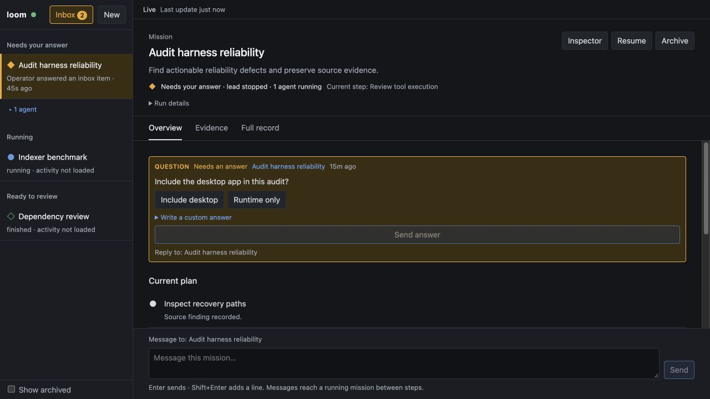

# The web UI

The operator supervises missions through four static files in `ui/`: `index.html`, `style.css`,
`core.js`, and `app.js`. The daemon embeds them; there is no frontend build step or runtime
framework. `core.js` owns pure state and presentation decisions; `app.js` owns DOM and network IO.

## Content and authority

- Keep the daemon's strict CSP: scripts, styles and requests are same-origin; no inline handlers,
  executable record content, remote images, analytics, or third-party resources.
- Model prose may use a small presentation subset: headings, paragraphs, lists, bold text, inline
  code and fenced code. Create each element and text node directly. Source HTML, links and images
  stay inert. Every formatted response also exposes its exact raw text. Tool output stays raw.
- The event log remains the record. Overview text is derived deterministically from records and
  typed ledger fields; it is not a generated summary or a substitute for the full record.
- Display a quote's attestation as “Quote matches stored output.” Keep that distinct from recorded
  claim status and independent verification. Opening evidence in the UI never changes model
  observation coverage or verifies a claim.
- Authenticate every same-origin request through the existing daemon cookie. A `401` replaces the
  page with the instruction to run `loom open` again.

## Missions and navigation



The sidebar groups root sessions into Needs your answer, Running, Ready to review, and Other
missions. Blocking child inbox items contribute to their mission's attention. Agents are collapsed
under the root by default; opening an agent expands its ancestors. Peer order stays based on creation
order inside each group. Archived roots remain hidden until Show archived is enabled.

Blocking requests, nonblocking questions and available results have different labels. Only blocking
requests use the urgent attention treatment. Mission rows show recorded activity and its age;
activity that has not been loaded is explicitly unknown. Token counts and step counters are run
details rather than a measure of completion.

Routes are `#/s/<id>/overview`, `/evidence`, and `/record`; the old `#/s/<id>` route opens Overview.
`#/inbox` and `#/new` retain their meaning. Browser Back/Forward restores the selected mission view.

The header keeps the goal and current plan step visible at all supported widths. Overview is the
default, with current questions, the recorded plan, outstanding claims and obligations, and recent
recorded changes. After a prior visit, changes are filtered after the last fully loaded sequence
seen when leaving. Only sequence watermarks and inspector width are saved in tab-scoped storage;
message and answer text stays in memory.

Evidence lists claims with their recorded status, source quotes and remaining notes. Each source
reference opens its cited range with surrounding context. Full record retains all previous event
presentation: native tool call/result pairing, explicit missing results and output cuts, child
reports, re-weaves, inbox resolutions, request details, reasoning and live output. Scrolling up
stops following new output and reveals Jump to latest. Activity links open their corresponding
record blocks.

## Drafts, submissions and updates

Drafts are keyed by session ID for messages and item ID for inbox answers. They survive mission/view
switching, stream reconnection and snapshot refreshes while the page remains open. They do not
persist after a page reload or tab closure. Keyed inbox nodes preserve focus and selection when
another question arrives. Suggested answers fill the draft and require Send answer; they never
submit automatically. When suggestions exist, a disclosure exposes the editable custom answer.

Capture the destination and submitted text before awaiting a request. An acknowledgement for one
mission must not clear another mission's draft or steal its focus. Clear a draft only if its value
still equals the submitted text. Disable duplicate in-flight submissions per destination. Require a
fully loaded initial record watermark before sending or correlating delivery. A message accepted by
the API waits for its matching recorded receipt before another submission reuses that watermark;
a following model-request event updates its delivery standing. These are observable UI receipts,
not proof that the model understood the message.

Stop, Resume, Archive and Unarchive have explicit pending states. Stop's description identifies its
scope: the session, descendant agents and tracked jobs. Message receipts distinguish acceptance,
recording and a subsequent model step. Failures retain the draft and explain what happened.

Snapshot requests use destination and request-generation guards on both success and failure.
Session/inbox refreshes must not overwrite newer stream events. Connection status and snapshot
freshness remain separate from mission attention; a disconnected stream makes execution standing
unknown while retaining the last update time.

## Inspector and responsive behavior

The mission inspector is closed by default. It contains Ledger, Context, Network and Session tabs.
On a wide display, opening it adds a resizable side pane. Drag the separator or use its arrow keys;
Home/End select the bounds. On narrower displays it becomes a drawer. Below 700px the mission
sidebar is also a drawer. Closed surfaces are inert; modal drawers trap keyboard focus, close with
Escape, and restore focus. Background content is inert while a modal drawer is open.

Tabs have explicit tab/tabpanel semantics and arrow/Home/End keyboard navigation. Use system text
for prose and monospace for source, commands and logs. Keep visible focus, readable form controls,
light/dark appearance and reduced-motion support. Avoid dependence on color or hover alone.

## Stored output dialog

Use a native modal dialog with an accessible title, focus containment, Escape dismissal and focus
restoration, including when a live update replaces the original source button. The viewer shows
snapshot identity, producing session/call when available, numbered lines and highlighted citations.
It supports paging, Go to line, copying the source reference, and literal Find in displayed lines.
Search is explicitly limited to the loaded range; it does not claim to search an entire unseen blob.
Jumping to another line updates the copied citation. Loading an old range cannot overwrite a newly
opened source dialog.

## Validation

Run the pure regressions and safety checks with:

```sh
node --test ui/core.test.js
node --check ui/app.js
```

For browser checks without a model or real daemon:

```sh
node tools/ui-preview.mjs
```

Open the printed loopback URL. The fixture contains two missions, a running agent, a blocking
question, a nonblocking completed result, formatted/inert source text and cited output around line
1596. Message responses are delayed so navigation during submission can be checked. The fixture-only
`POST /__fixture/question` injects a nonblocking arrival, and `POST /__fixture/reconnect` drops the
stream to exercise refreshes. `GET /__fixture/state` lists only synthetic submission receipts.

Check mission and answer draft isolation, focus after an arrival/reconnect, duplicate submission
prevention, evidence jumps/search/copy, Back/Forward, inspector tabs/resizing, closed-drawer tab order,
modal focus restoration, and 320px/desktop layouts. The preview binds loopback and never reads
credentials, starts a model or writes a workspace. Rust/native builds follow the separate-host rule
in `docs/IMPLEMENTING.md` and `gui/DESIGN.md`.
